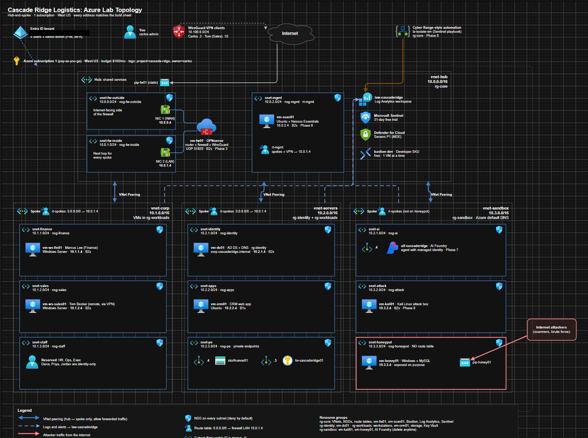

# Cascade Ridge Logistics: Azure Security Lab

I'm building a small fake company in Microsoft Azure from scratch so I can learn how a real environment is put together, secured, monitored and attacked. The company is called Cascade Ridge Logistics. It has five employees, an admin account, a hub-and-spoke network, a firewall I configured myself, a domain controller with hardened Group Policy, department file shares full of fake company data, and eventually a CRM app, Sentinel monitoring, an AI agent sandbox and an attack box.

This repo is my build log. It's a work in progress, and I add to it as I finish each phase.



*The planning diagram I drew before building anything. Some labels (like the firewall VM size) changed during the build. The write-ups have the final values.*

## Why I'm doing this

I work in IT support and I'm moving into blue team security (SOC and incident response). Hunting in someone else's environment taught me a lot, but I wanted to understand the other side: how the network is laid out, why traffic goes where it does, and what breaks when something is misconfigured. The design is a smaller, budget-friendly version of the Cyber Range architecture I trained on.

The rules I set for myself:

* Build everything by hand in the portal first so I understand it, then script it where it makes sense
* Keep it under about $100 a month
* Document what went wrong, not just what worked

## Progress

| Phase | What gets built | Status |
|---|---|---|
| [0. Foundation](docs/phase-0-foundation.md) | Subscription, budget alerts, region, resource groups | Done |
| [1. Identity](docs/phase-1-identity.md) | Employees, groups, separate admin account, MFA, Conditional Access, PIM | Done |
| [2. Network](docs/phase-2-network.md) | Hub VNet plus 3 spokes, 12 subnets, 12 NSGs, peerings | Done |
| [3. Firewall](docs/phase-3-firewall.md) | OPNsense firewall, WireGuard VPN, NAT, segmentation rules, route tables, testing | Done |
| [4. Active Directory](docs/phase-4-active-directory.md) | Real domain, domain controller, GPO hardening, LAPS, audit policy, private file shares, workstations, sync to Entra | In progress |
| 5. Workloads and data | CRM app, storage and Key Vault behind private endpoints | Planned |
| 6. Security monitoring | Log Analytics, Sentinel, Defender for Cloud, Nessus | Planned |
| 7. AI agent sandbox | An agentic AI system in an isolated spoke, limited by identity and the firewall | Planned |
| 8. Attack and defend | Kali and an internet-facing honeypot, detections, incident reports | Planned |

## The design in one paragraph

Everything sits in one subscription in West US. There's a hub VNet (10.0.0.0/16) that holds the firewall and a management subnet, and three spokes: corp (10.1.0.0/16) for employee workstations, servers (10.2.0.0/16) for the domain controller and apps, and sandbox (10.3.0.0/16) for the attack box, honeypot and AI agent. Spokes only peer with the hub, never with each other, and every spoke's route table points at the firewall. That means any traffic between spokes or out to the internet has to pass through OPNsense, where I decide what's allowed. The only door in from the internet is a WireGuard VPN on one UDP port.

More detail is in the [network reference](docs/network-reference.md).

## Things that broke (and what they taught me)

Some of the most useful parts of this build were the problems. A few highlights:

* I locked my own admin account out with a Conditional Access policy and had to get back in with a break-glass account
* Azure quietly attached a second firewall rule set to my firewall's network card that would have silently dropped all forwarded traffic
* My SSH test timed out even though the firewall logs said "pass," which turned out to be an Azure rule on the way out of the firewall
* My first route table design would have let traffic skip the firewall because of how Azure picks the most specific route
* My file share script reported success for a share that was never created, because PowerShell only warned instead of stopping

The full list is in [lessons learned](docs/lessons-learned.md).

## Skills this covers so far

* Microsoft Entra ID: users, groups, RBAC vs directory roles, Conditional Access, PIM, sign-in log troubleshooting
* Azure networking: VNets, subnets, NSGs, peering, user-defined routes, IP forwarding
* Firewall administration: OPNsense gateways, static routes, outbound NAT, aliases, rule ordering, live log analysis
* Remote access: WireGuard site setup with a split tunnel
* Active Directory: forest setup, DNS, OUs, groups, separate admin accounts, PowerShell automation
* Group Policy hardening: password and lockout policy, SMBv1 off, Windows LAPS, advanced audit policy
* Azure Files: private endpoints, private DNS, AD authentication with Kerberos, share and NTFS permissions
* Cost control: budgets, alerts, auto-shutdown on every VM
* Troubleshooting: following a packet hop by hop and proving where it gets dropped

## Repo layout

```
docs/       one write-up per phase, plus the network reference and lessons learned
images/     screenshots from each phase (sensitive values blacked out)
scripts/    scripts I used during the build
```

## A note on what's hidden

This is my real lab, so I blacked out anything that identifies my tenant or accounts: email addresses, the tenant domain, subscription and object IDs, and the firewall's public IP. Passwords and keys never appear anywhere in this repo.
