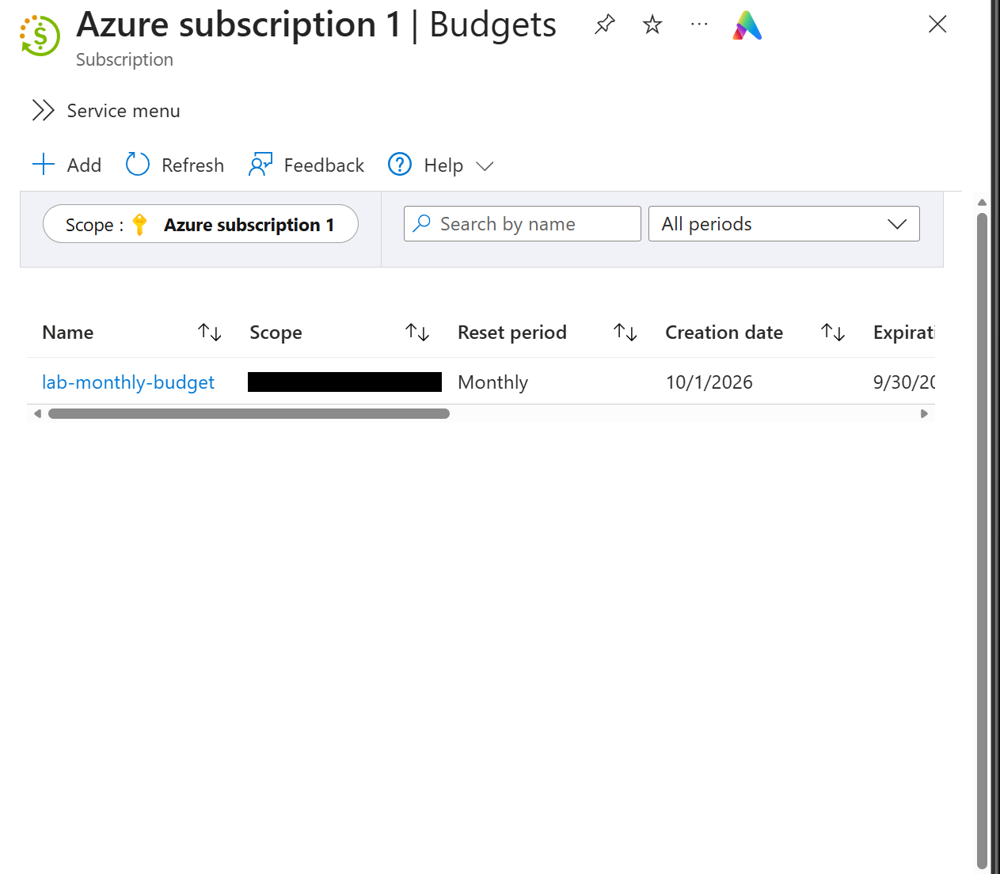
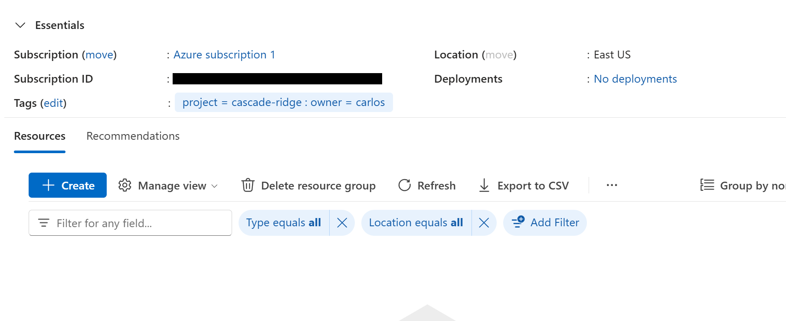
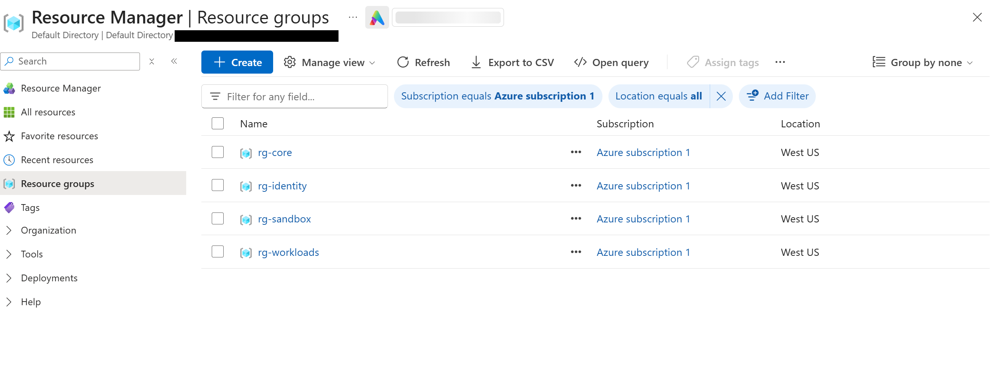

# Phase 0: Foundation and Guardrails

**Dates:** Oct 26, 2026
**Goal:** Get a subscription with cost controls and a planned layout in place before creating anything that costs money.

[Back to README](../README.md) | [Next: Phase 1](phase-1-identity.md)

## What I did

* Signed in to Azure with a personal Microsoft account, kept completely separate from anything at work
* Activated the Azure free account, which came with a $200 credit good until Nov 25, 2026
* Created a budget called `lab-monthly-budget`: $100 a month, with alerts at 25, 50 and 75 percent of actual spend and 100 percent of forecast
* Picked West US as my region because it's the closest region to me that offers the free Bastion Developer SKU
* Created four resource groups, all tagged `project=cascade-ridge` and `owner=carlos`
* Confirmed two-step verification was on for the account that owns everything
* Wrote out a build sheet (every resource, IP and rule) and drew the topology before building

## Budget first

Pay-as-you-go Azure has no spending cap. Budgets only send alerts; they never stop anything. So the real cost controls are watching the alerts, putting auto-shutdown on every VM, and deleting what I'm not using. I set the budget up before creating a single resource.

## Resource groups

I split resources the way a real company might split ownership between a network team and server teams:

| Resource group | What goes in it | Why it's separate |
|---|---|---|
| rg-core | VNets, NSGs, route tables, the firewall, monitoring | The backbone. Gets deleted last. |
| rg-identity | The domain controller | It's the crown jewel, so it can get its own access rules |
| rg-workloads | Workstations, CRM app, storage, Key Vault | The company's "business" resources |
| rg-sandbox | Kali, honeypot, AI resources | Risky and disposable. I can delete the whole group anytime. |

My first try landed in East US because that's the portal default, and a resource group's region can't be changed after it's created. I deleted the empty groups and recreated them in West US.

## Small hiccups

* The free trial page told me "limited to one per customer" and the portal said it couldn't load my credit info. Both turned out to be provisioning delays. About an hour later the $200 credit showed up on the subscription. Lesson: check the subscription overview before assuming something failed.

## Key takeaway

Cost control in Azure is a habit, not a setting. Alerts tell you about a problem, but nothing stops a VM from running all month except you.
