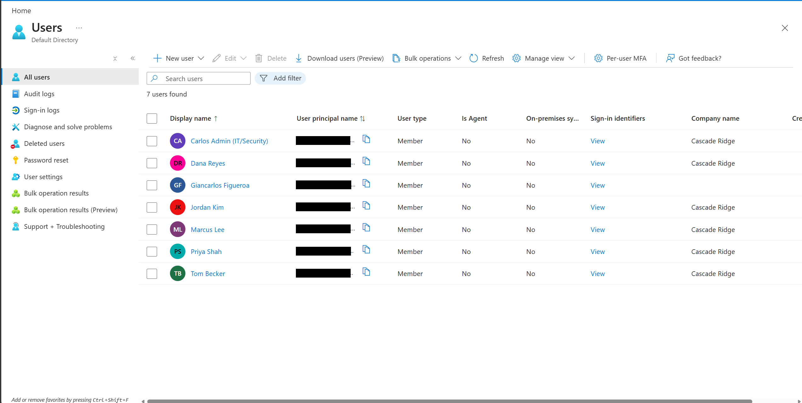
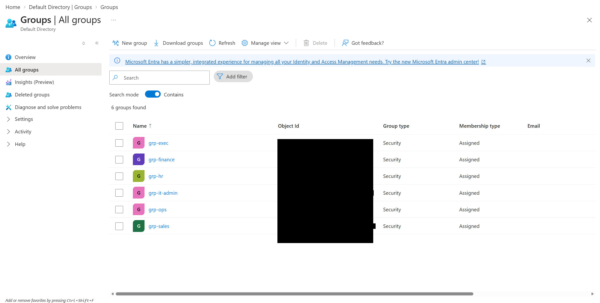
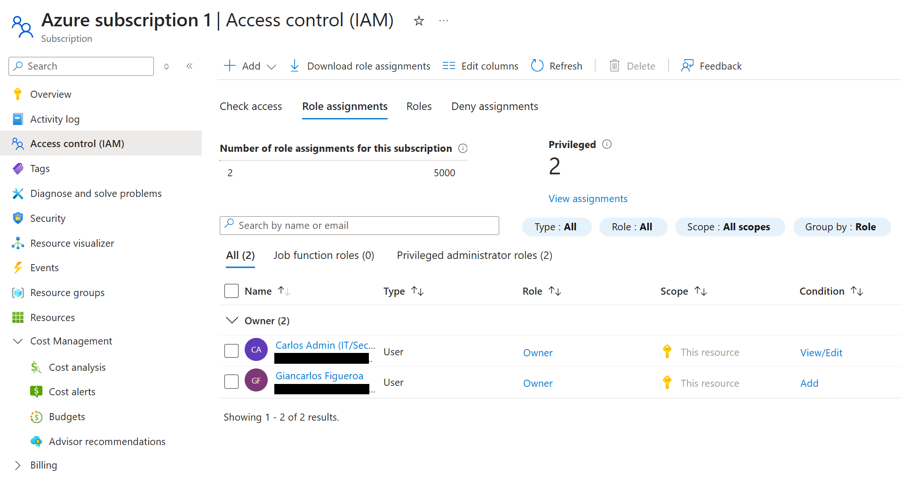
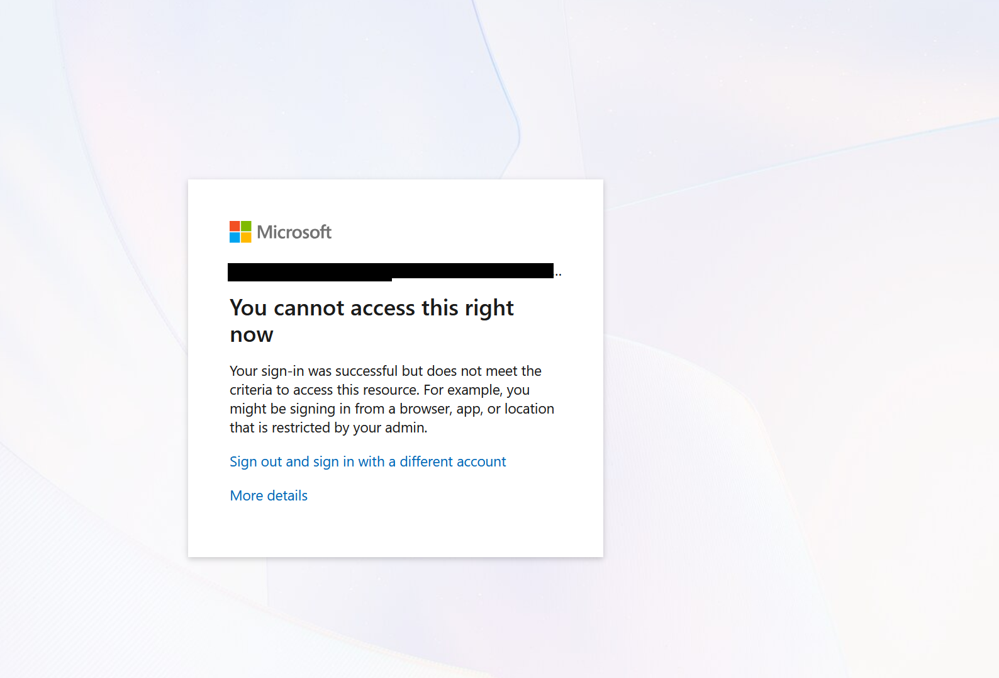
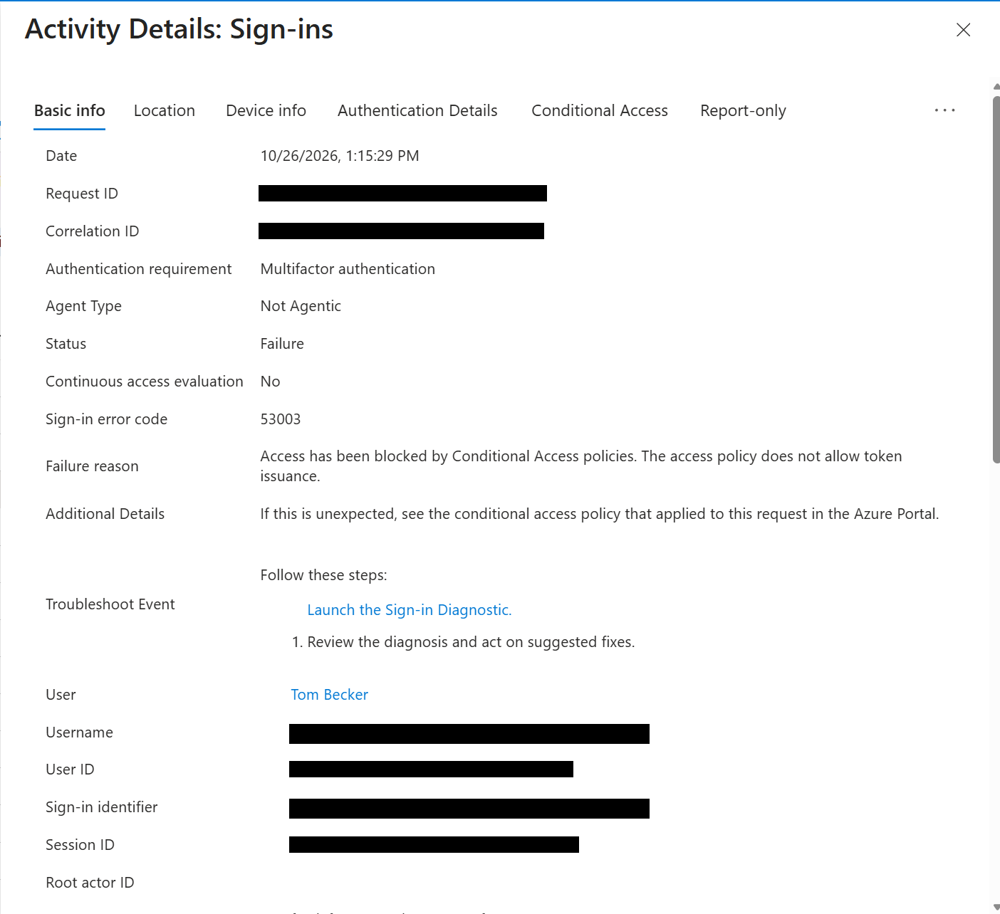
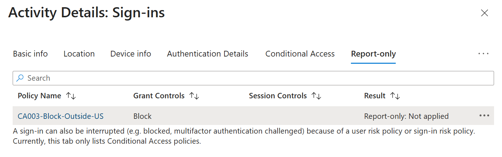
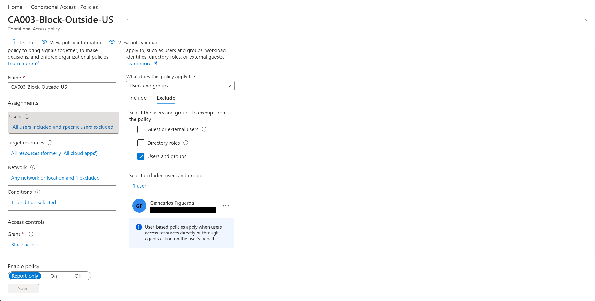
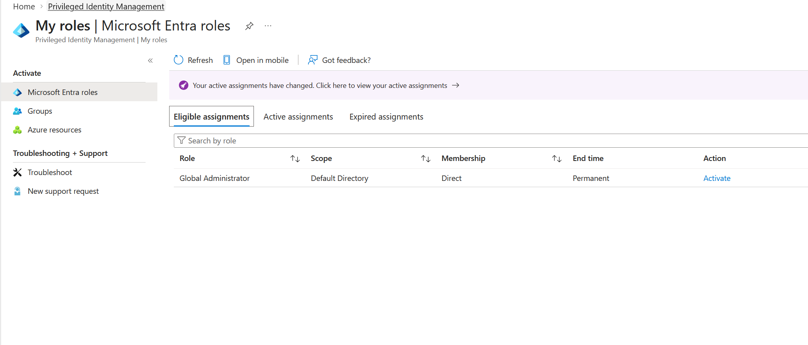
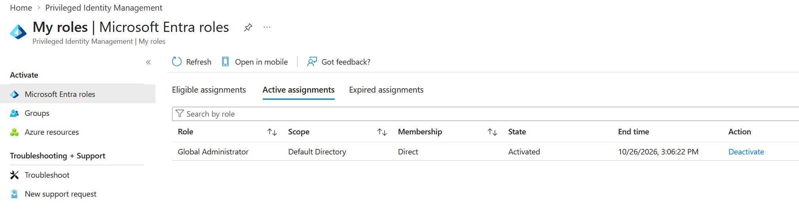

# Phase 1: Identity

**Dates:** Oct 26, 2026
**Goal:** Give the company its five employees and a separate admin account in Entra ID, protected by MFA, Conditional Access and PIM.

[Back to README](../README.md) | [Previous: Phase 0](phase-0-foundation.md) | [Next: Phase 2](phase-2-network.md)

## The people

| User | Role | Group |
|---|---|---|
| dana.reyes | CEO | grp-exec |
| marcus.lee | Finance Manager | grp-finance |
| priya.shah | HR Coordinator | grp-hr |
| tom.becker | Sales Rep (remote) | grp-sales |
| jordan.kim | Operations Lead | grp-ops |
| carlos-admin | IT and Security Admin | grp-it-admins |

The employees get no admin roles at all. My personal account stays as the **break-glass** account: it's excluded from every Conditional Access policy so I always have a way back in, and I don't use it for daily lab work.

## Two kinds of admin access

The first thing that confused me: I gave carlos-admin the Global Administrator role, signed in, and the portal said I didn't have a subscription. That's because Entra ID roles (who can manage users and the directory) and Azure RBAC roles (who can manage resources like VMs and networks) are two separate systems. I had to assign Owner on the subscription separately.

## Licensing

Conditional Access and PIM need Entra ID P2. Buying or trialing licenses has moved to the Microsoft 365 admin center, so the "Try / Buy" buttons in Entra were greyed out. I started the free P2 trial from the M365 Marketplace, assigned it to all seven users, and turned off recurring billing right away so it wouldn't roll into a paid plan.

## Conditional Access

I turned off Security Defaults and replaced them with three policies, all excluding the break-glass account:

| Policy | What it does |
|---|---|
| CA001-Require-MFA-AllUsers | Everyone needs MFA |
| CA002-Block-Legacy-Auth | Blocks old protocols that can't do MFA (Exchange ActiveSync and "other clients") |
| CA003-Block-Outside-US | Blocks sign-ins from anywhere outside a named location called Allowed-US |

## How I locked myself out

Right after saving a block policy, carlos-admin got this:

I signed in with the break-glass account, checked the policies and the sign-in logs, and moved CA003 back to Report-only. I also tested with Tom's account, which got blocked with error 53003 (blocked by Conditional Access).

A few minutes later, once the change propagated, Tom could sign in. Then I tested CA003 properly in Report-only mode. The sign-in details showed "Report-only: Not applied" for my US sign-ins, meaning the policy would have let them through, so I switched it On.

What I learned from this:

* Always exclude an emergency access account before turning on a block policy
* Test block policies in Report-only first
* Mobile and VPN IPs can geolocate somewhere unexpected. My phone's IPv6 address showed up as Emporia, which can trip location rules
* Sign-in logs lag 5 to 15 minutes, so a fix can look like it didn't work at first

## PIM

Instead of leaving carlos-admin as a permanent Global Admin, I made the role **eligible** through Privileged Identity Management. To use it, I have to activate it for up to one hour, with MFA and a written justification. Most of the time the admin account has no standing admin rights.

## Key takeaway

Identity is the real perimeter in the cloud. Separate admin accounts, MFA everywhere, just-in-time admin rights and a tested break-glass account are the basics, and testing them in a lab is a lot cheaper than learning them in production.
