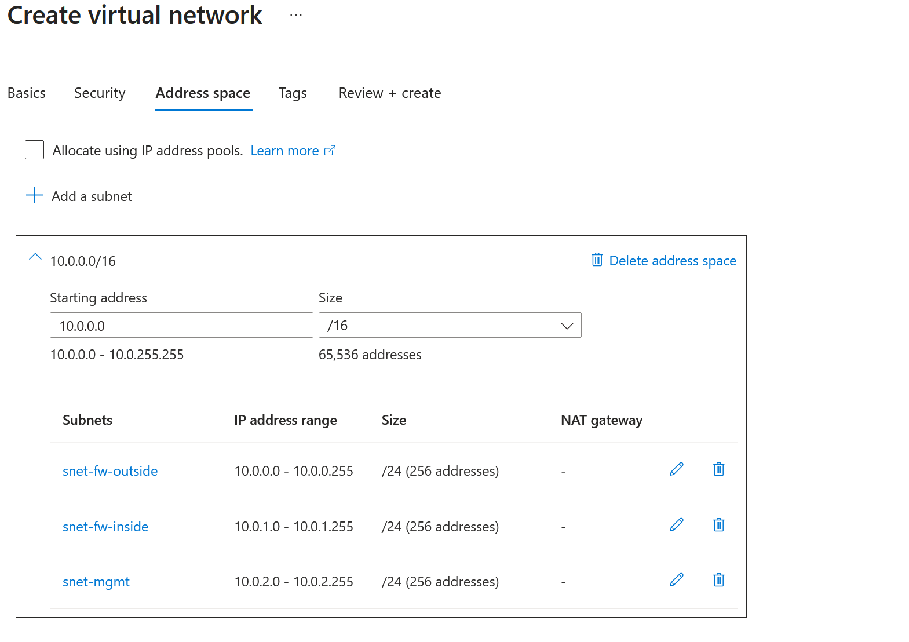
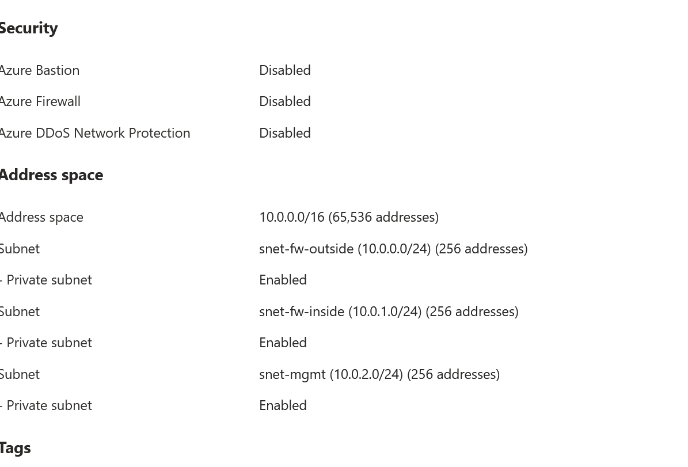
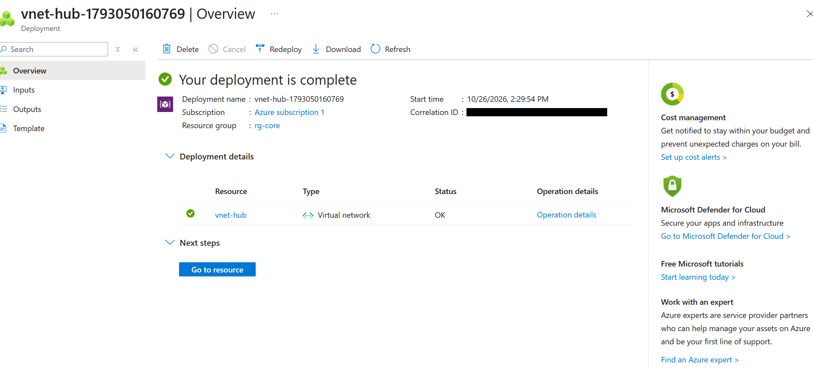

# Phase 2: Network Core

**Dates:** Oct 26 to Oct 28, 2026
**Goal:** Build the hub, the three spokes, every subnet, an NSG on each subnet, and the peerings, all matching the build sheet.

[Back to README](../README.md) | [Previous: Phase 1](phase-1-identity.md) | [Next: Phase 3](phase-3-firewall.md)

## Hub and spoke

The idea behind hub-and-spoke is simple: one central network (the hub) holds the shared services, especially the firewall, and every other network (a spoke) connects only to the hub. Spokes never talk to each other directly. That gives me one place to inspect and control traffic.

| VNet | Address space | Subnets |
|---|---|---|
| vnet-hub | 10.0.0.0/16 | snet-fw-outside 10.0.0.0/24, snet-fw-inside 10.0.1.0/24, snet-mgmt 10.0.2.0/24 |
| vnet-corp | 10.1.0.0/16 | snet-finance, snet-sales, snet-staff |
| vnet-servers | 10.2.0.0/16 | snet-identity, snet-apps, snet-pe (private endpoints) |
| vnet-sandbox | 10.3.0.0/16 | snet-ai, snet-attack, snet-honeypot |

Each VNet gets a /16 and each subnet a /24, which leaves room to add subnets later without renumbering anything.

I left Azure Bastion, Azure Firewall and DDoS protection off on the hub. They're paid services, and the whole point of this lab is to run my own firewall.

## NSGs on every subnet

Every subnet got its own Network Security Group, 12 in total. I built the first four by hand to understand them, then created the other eight with a short Azure CLI script in Cloud Shell. The script is in [scripts/create-nsgs.sh](../scripts/create-nsgs.sh).

The important rule is `Deny-VNet-Inbound` at priority 4000 on every NSG. Azure's built-in `AllowVnetInBound` rule allows anything from the "VirtualNetwork" tag, and that tag includes peered VNets. Without an explicit deny, every spoke could reach every other spoke as soon as peering was turned on. The one exception is `nsg-fw-inside`, which allows all of 10.0.0.0/8 because every spoke's traffic has to reach the firewall.

## Peering

I peered the hub to each spoke in both directions, with "allow forwarded traffic" on both sides and no spoke-to-spoke peering. Forwarded traffic matters because when the firewall passes a packet along, the packet still has its original source IP. Without that setting, the spoke would drop it.

## Problems I hit

* **"Subnet address range is not contained in the address space."** The new VNet still had the pre-filled 10.0.0.0/16. I had to set the VNet's address space first (10.1.0.0/16), then add subnets inside it.
* **My script came out scrambled in Cloud Shell.** Copying from Windows adds carriage returns that break multi-line pastes. I saved the script with nano, stripped the carriage returns with `sed -i 's/\r$//'`, and ran it as a file. Cloud Shell also needed the `Microsoft.CloudShell` provider registered first.

## Key takeaway

New subnets in Azure are private by default and have no automatic way out to the internet. Every VM needs an explicit path out, and here that path is the firewall, so nothing calls home unless I allow it.
