# Phase 3: Router and Firewall

**Dates:** Oct 28 to Oct 29, 2026
**Goal:** Put an OPNsense firewall in the hub, reach it only through a VPN, and force all spoke traffic through it.

[Back to README](../README.md) | [Previous: Phase 2](phase-2-network.md) | [Next: Phase 4](phase-4-active-directory.md)

This was the hardest phase so far and the one I learned the most from. It's split into four parts: deploying the firewall, setting up the VPN, configuring OPNsense, and pointing Azure at it.

## Part 1: Deploying OPNsense

OPNsense is an open source firewall. The Azure Marketplace image is billed per hour for the software (not covered by credits), and free accounts can't buy paid Marketplace offers, so I upgraded the subscription to pay-as-you-go. My remaining credit carried over, but the spending limit went away, which is why the budget alerts from Phase 0 matter.

* **VM:** vm-fw01, Standard_D2als_v6 (B-series sizes were blocked in West US), Standard SSD, auto-shutdown at 11 PM, boot diagnostics on so the Serial Console works
* **Two network cards**, like a physical firewall's two ports:

| NIC | Subnet | Private IP | Role |
|---|---|---|---|
| WAN | snet-fw-outside | 10.0.0.4 | Faces the internet, has the public IP |
| LAN | snet-fw-inside | 10.0.1.4 | Faces the spokes, next hop for all of them |

Both NICs have **IP forwarding** turned on. By default Azure drops any packet that reaches a NIC unless it's addressed to that NIC. A firewall's whole job is passing along traffic meant for other machines, so this setting tells Azure "this NIC is a router."

The Marketplace image labeled my only NIC as LAN, which was backwards. I reassigned the interfaces from the Serial Console instead of the web UI, so a mistake couldn't lock me out.

## Part 2: WireGuard VPN

I didn't want the firewall's admin page on the internet at all. I set up a WireGuard tunnel (10.100.0.0/24) with a split tunnel, so only traffic for the lab's 10.0 to 10.3 ranges goes through it. Then I deleted the temporary rules I used for the first login and confirmed the web UI times out from the internet but loads fine over the VPN.

The only thing exposed to the internet is UDP 51820 for WireGuard.

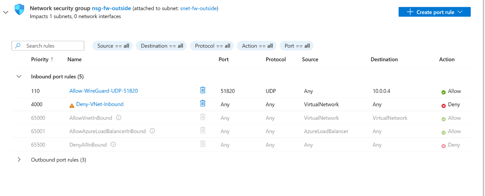

## Part 3: Configuring OPNsense

### Removing a hidden NSG

Before routing anything, I checked the LAN NIC and found a second NSG I didn't create. Azure had attached `basicNsgnic-fw01-lan` directly to the network card when I added it.

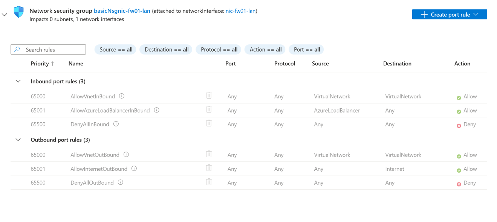

Subnet NSGs and NIC NSGs stack, and traffic has to pass both. This one only had Azure's default rules. The default `AllowVnetInBound` only matches traffic whose destination is also inside the VNet, so a spoke VM browsing the internet would have hit `DenyAllInBound` right at the firewall's door. I dissociated it, leaving `nsg-fw-inside` as the only filter.

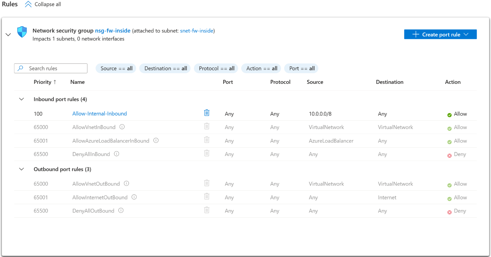

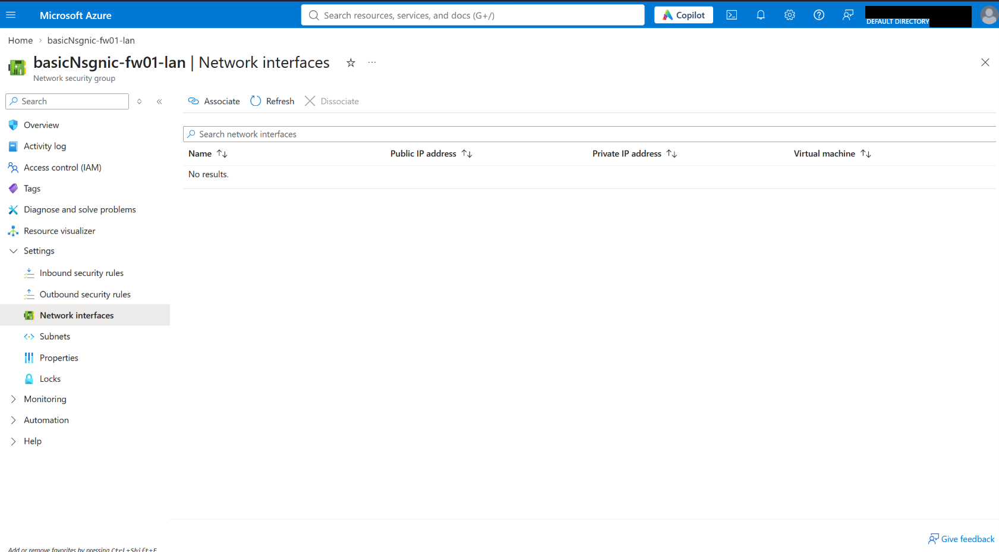

### Gateway and static routes

OPNsense only knew about the two subnets its NICs sit on. To reach the spokes, it needs a gateway on the LAN side. Azure reserves the first four addresses and the last address in every subnet, and `.1` is always Azure's built-in router. On the LAN subnet that's 10.0.1.1.

I created `LAN_AZURE_GW` at 10.0.1.1 with monitoring off (Azure's router doesn't reliably answer pings) and not marked as upstream, so WAN stays the only default route to the internet.

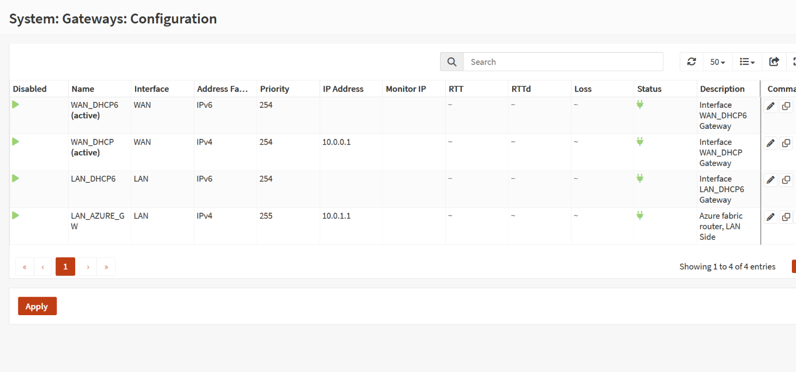

Then I added static routes for the three spokes and the management subnet through that gateway.

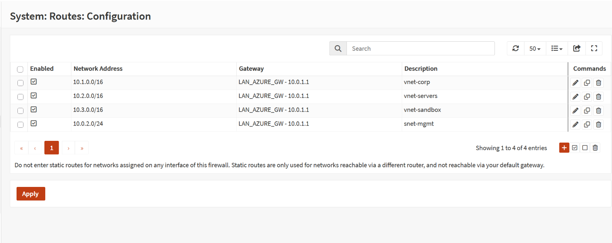

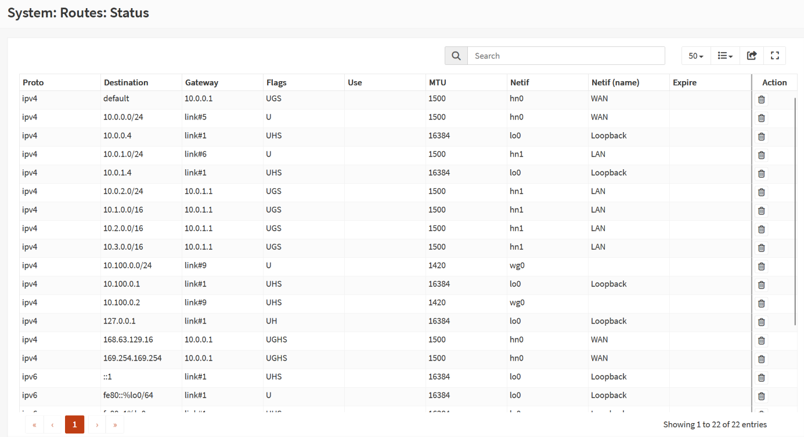

### Outbound NAT

Spoke VMs have private addresses, and the internet can't reply to a private address. Outbound NAT swaps the private source for the firewall's WAN address on the way out.

When I expanded the automatic NAT rules, they only covered the loopback network. Nothing for LAN or the spokes. Once LAN had a gateway, OPNsense started treating it as an outside interface, and networks reached through static routes are never covered automatically anyway.

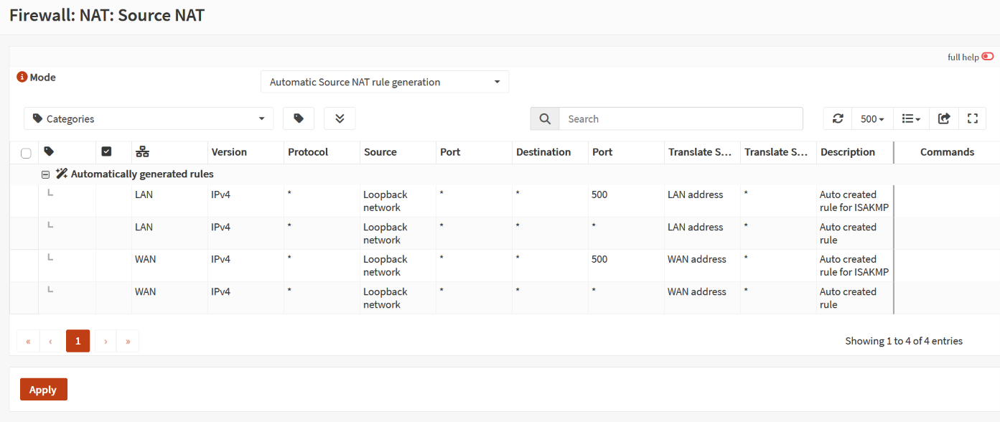

I switched to Hybrid mode and added one rule on WAN for all of 10.0.0.0/8. There's no NAT on LAN on purpose, so traffic between my VPN and the spokes keeps its real source IPs. That will matter in Phase 6 when I'm hunting in Sentinel and need to see which machine actually did something.

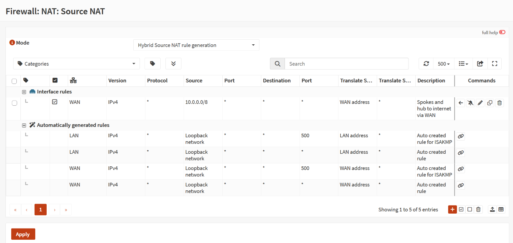

### Segmentation rules

I made aliases (named groups of addresses) so the rules and logs are readable, then built the LAN rules. OPNsense checks rules top to bottom, first match wins, and anything that doesn't match is blocked.

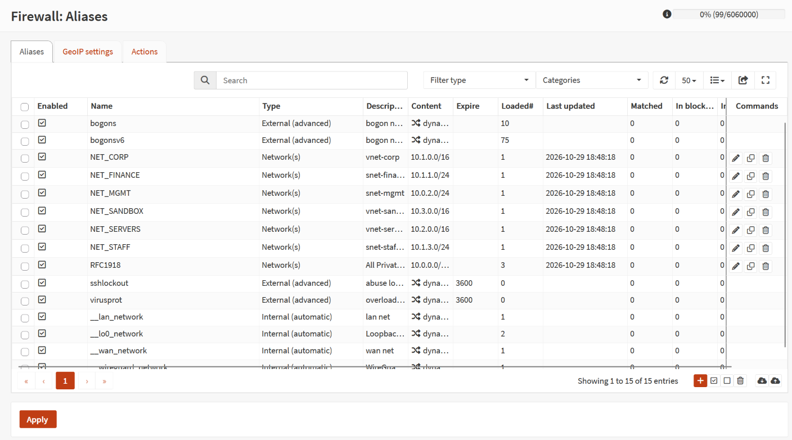

| Order | Action | From | To | Why |
|---|---|---|---|---|
| 10 | Block, logged | Sandbox | All private ranges | The attack box and AI agent can't reach the company |
| 20 | Block, logged | Finance | Staff/HR | Finance can't reach HR |
| 30 | Pass | Corp | Servers | Workstations need the domain controller and CRM |
| 40 | Pass | Mgmt | All private ranges | The Nessus scanner needs to reach everything |
| 50 | Pass | 10.0.0.0/8 | Anything **not** private | Internet access only |

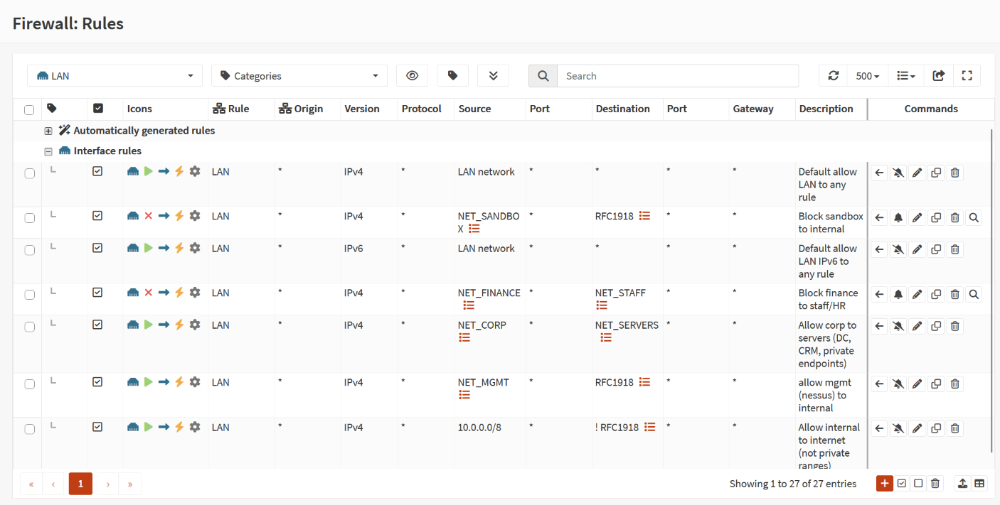

The last rule uses an inverted destination (`!RFC1918`), which means "any address that isn't private." So every subnet can reach the internet, but that rule can never be used as a path between subnets. Internal traffic only gets through when a rule explicitly allows it.

Blocks are logged so I'll have evidence of the attack box probing in Phase 8. Allowed traffic isn't logged, because constant workstation to DC traffic would bury everything else.

The firewall decides which **networks** can talk. The NSGs on each server subnet decide which **ports** are open. That way I don't have to maintain the long list of AD ports in two places.

## Part 4: Azure route tables

None of the rules above see anything until Azure sends traffic to the firewall. That's what user-defined routes do.

**rt-spokes** is attached to every spoke subnet except the honeypot.

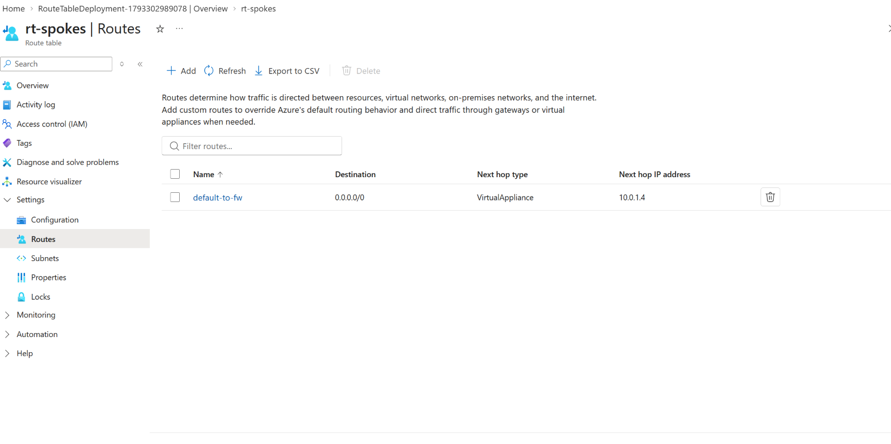

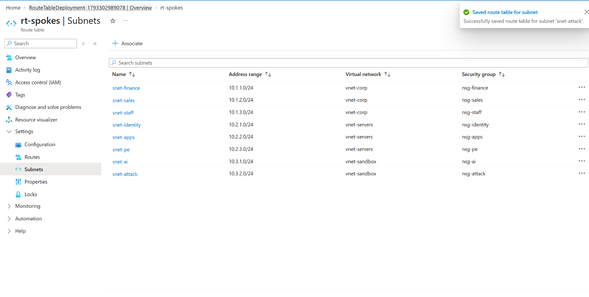

The honeypot is left off on purpose. It has its own public IP, and if its replies went out through the firewall they'd leave from a different address than the attacker connected to, which breaks the connection (asymmetric routing).

**rt-mgmt** is attached to the management subnet.

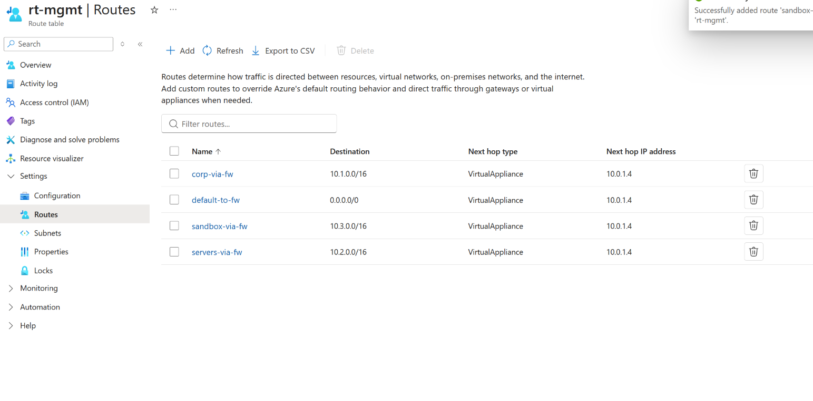

### The mistake I almost made

My first plan for rt-mgmt was a single 0.0.0.0/0 route to the firewall. That wouldn't have worked. Peering adds its own routes for each peered VNet (a /16), and Azure always picks the most specific route. A /16 beats /0, so mgmt to spoke traffic would have gone straight across the peering and skipped the firewall.

The fix was to add routes with the same /16 prefixes (when prefixes tie, my route beats Azure's) and a `10.0.2.0/24` route in rt-spokes so replies to the scanner come back through the firewall too. If traffic goes out through the firewall but comes back around it, the firewall drops the reply because it never saw the connection start.

## Testing it

I built a throwaway Ubuntu VM (vm-test01) in the attack subnet with no public IP and ran three tests.

### Test 1: SSH over the VPN

The first try timed out. To find out where, I watched the OPNsense live log while connecting.

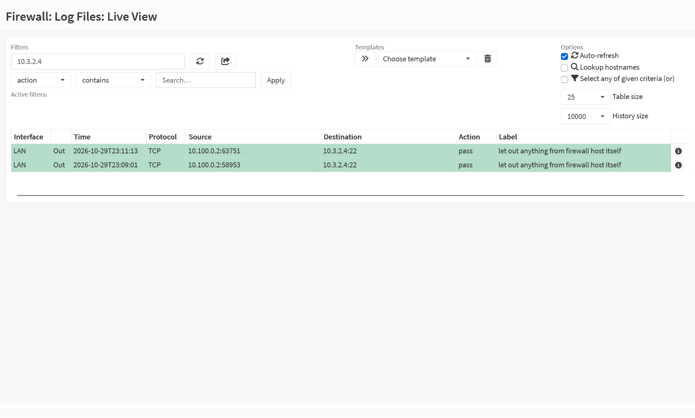

The firewall was passing it out the LAN side, so the drop had to be in Azure. VPN traffic leaves the firewall with its real source (10.100.0.2), and that range isn't part of any Azure VNet. It didn't match `AllowVnetOutBound` and hit `DenyAllOutBound` on the firewall's own subnet. One outbound rule fixed it.

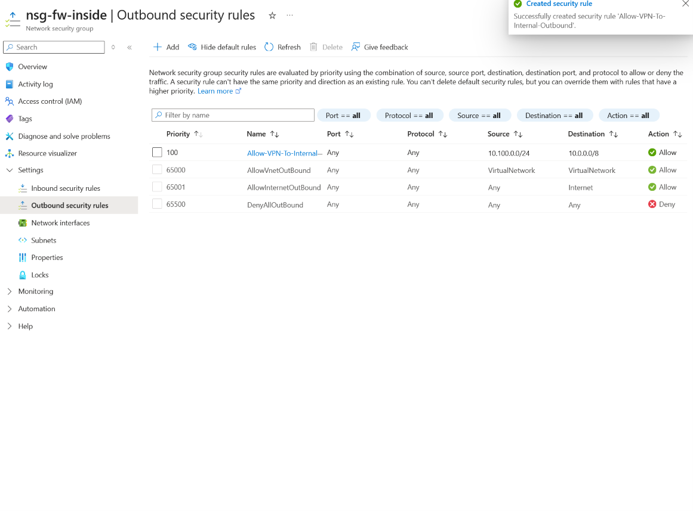

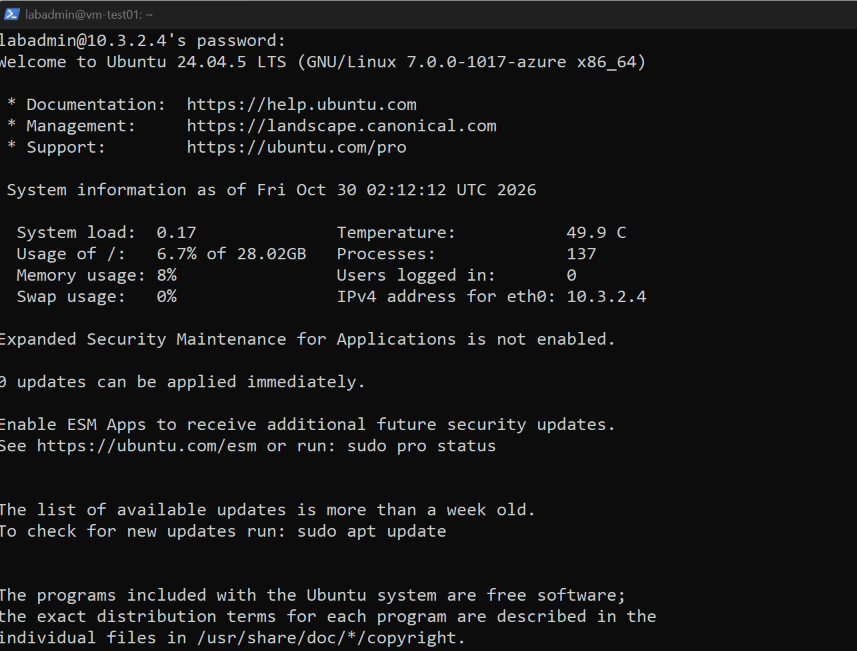

### Test 2: Internet goes out through the firewall

From the test VM, `curl ifconfig.me` returned the firewall's public IP. That proves the path: VM, rt-spokes, OPNsense rule 50, outbound NAT, WAN, Azure's public IP, internet.

### Test 3: The sandbox can't reach the company

`ping 10.2.1.4` (where the domain controller will live) got 100 percent packet loss, and the firewall logged every packet as "Block sandbox to internal."

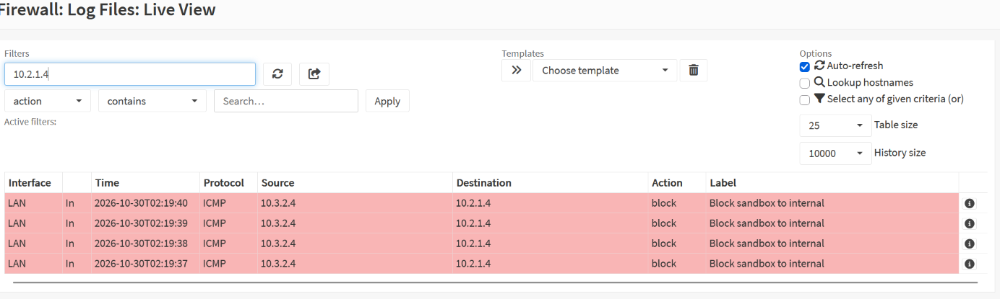

All three passed, and I deleted the test VM.

## Key takeaway

When the firewall says "pass" but nothing arrives, the problem is somewhere else on the path. Following one packet hop by hop, and checking both directions, is how I found every issue in this phase.
