# Phase 4: Active Directory and Hybrid Identity

**Dates:** Oct 30, 2026 to present (in progress)
**Goal:** Simulate an on-prem company inside Azure: a real domain, a domain controller, hardened Group Policy, department file shares with fake company data, domain-joined workstations, and eventually sync to Entra ID.

[Back to README](../README.md) | [Previous: Phase 3](phase-3-firewall.md)

This phase is still going. So far I have the domain, the domain controller, the security baseline, the file shares and the first workstation done and tested. Syncing AD to Entra ID is next, and I'll add it here when it's finished.

I'm building everything secure first. Once the whole environment is up, I'll open holes on purpose and attack them in Phase 8.

## Part 1: A real domain

I wanted this to feel like a real company, not a lab with a default Microsoft name, so I bought `cascaderidgelogistics.com` and verified it in Entra ID with a TXT record. Employees will sign in as `name@cascaderidgelogistics.com`.

Active Directory uses a subdomain of it, `corp.cascaderidgelogistics.com`. That's what Microsoft recommends: the public name stays for the website and email, and the internal name lives under it, so the two never collide.

## Part 2: The domain controller

**vm-dc01** sits in the identity subnet at 10.2.1.4. It has no public IP, so the only way in is my WireGuard VPN, through the firewall, then RDP.

* Windows Server 2025 Datacenter Azure Edition, the **[smalldisk]** image (30 GB OS disk instead of 127 GB, since disks bill even when the VM is off)
* Standard_D2als_v6, about $0.19 an hour, with auto-shutdown at 11 PM
* A separate 8 GB data disk (F:) for the AD database and SYSVOL. Microsoft recommends keeping them off the OS disk, because the OS disk caches writes and AD needs them written right away.
* Static private IP, because every other machine will point at this one for DNS

I promoted it with `Install-ADDSForest`: new forest `corp.cascaderidgelogistics.com`, NetBIOS name `CASCADERIDGE`, DNS installed, and the database and logs on F:.

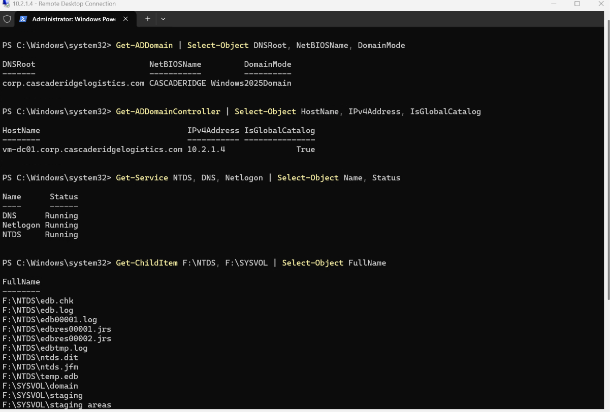

### DNS

The DC is now the DNS server for the company. For anything it doesn't know (like microsoft.com), it forwards to Azure's own DNS at 168.63.129.16.

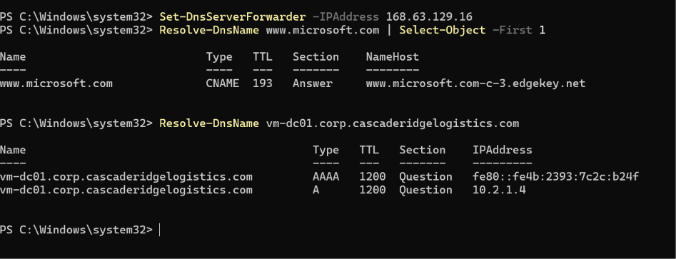

Then I set custom DNS (10.2.1.4) on **vnet-corp and vnet-servers only**. I left the hub and sandbox on Azure DNS on purpose. The firewall shouldn't stop working because one DC is down, and the attack box shouldn't get the company's internal DNS for free.

## Part 3: Users, groups and OUs

I wrote a PowerShell script to build the company's structure: [scripts/New-CascadeRidgeAD.ps1](../scripts/New-CascadeRidgeAD.ps1). It prompts for passwords instead of storing them.

* An OU tree under `CascadeRidge`: Users (one OU per department), Groups, Admin Accounts, Workstations, Servers, Service Accounts
* One security group per department: grp-exec, grp-finance, grp-hr, grp-sales, grp-ops, grp-it-admins
* The same 5 employees from Phase 1, plus my own regular user account, all as `@cascaderidgelogistics.com`
* **adm-carlos**, a separate Domain Admin account. I do admin work with that one, never with my daily account, so a phished regular account doesn't hand over the domain.

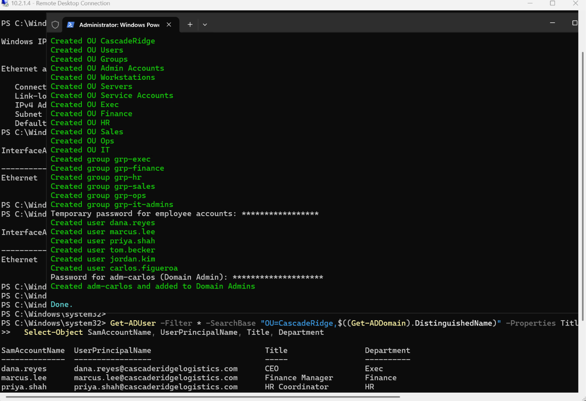

## Part 4: Hardening the domain

### Password policy and a baseline GPO

* Password policy: 14 characters minimum, complexity on, remembers the last 24, lockout after 5 bad attempts for 15 minutes
* A GPO called **CR-Baseline-AllComputers** linked to the whole domain. It turns off SMBv1 (the protocol WannaCry spread through) and locks the screen after 10 minutes idle.

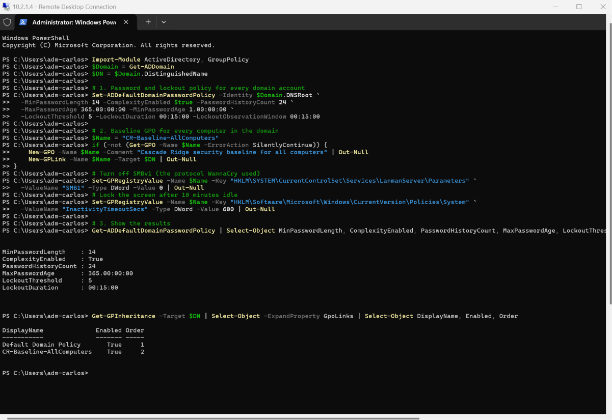

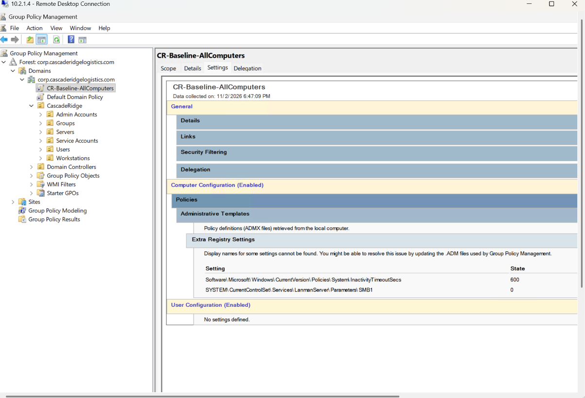

### Windows LAPS

Every Windows machine has a local admin account. If they all share one password, stealing it from one machine unlocks every machine (that's how pass-the-hash and lateral movement work). Windows LAPS gives every machine its own random local admin password, rotates it every 30 days, and stores it encrypted in AD where only admins can read it.

I updated the AD schema for LAPS, gave the Workstations and Servers OUs permission to write their own passwords, and linked a **CR-LAPS** GPO to both OUs (16 characters, 30 days, encrypted).

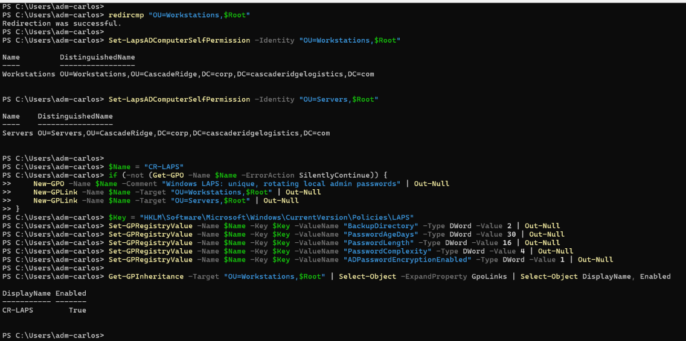

### Advanced audit policy (done by hand)

This is the part that feeds Sentinel later, so I built it by hand in Group Policy Management instead of a script, to learn the console. The **CR-Audit-Policy** GPO logs:

* Sign-ins, successful and failed (4624, 4625) and special logons by admins (4672)
* Kerberos tickets (4768, 4769), which is where attacks like Kerberoasting show up
* Account and group changes
* Every process that starts, **with its full command line** (4688)

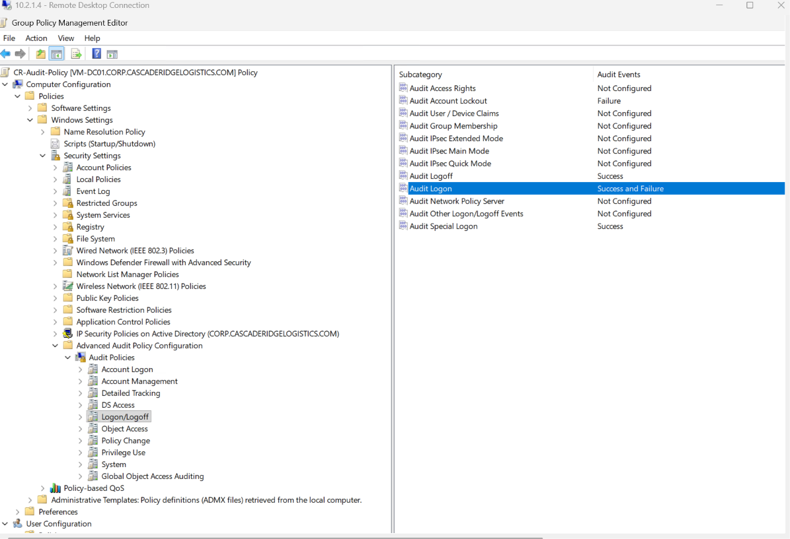

My first check with `auditpol` showed Logon as "No Auditing." I had missed a setting and also checked before Group Policy refreshed. After fixing it and running `gpupdate /force`, everything matched, and real 4624 events were already showing up.

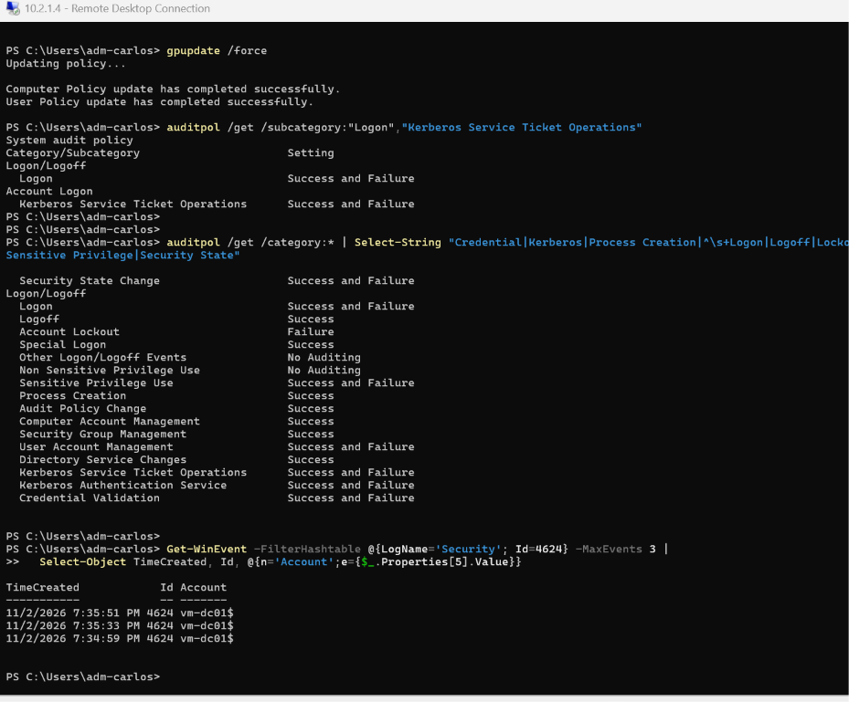

## Part 5: Department file shares

I wanted every department to have its own share, and each person to only reach their own department's files. I went with **Azure Files** joined to AD, behind a private endpoint, so the shares have no public access at all.

### Private endpoint

The storage account (stcrfiles01) has public network access turned off. Instead it gets a private IP, 10.2.3.4, in the private endpoint subnet, plus a private DNS zone so the normal name resolves to that private IP.

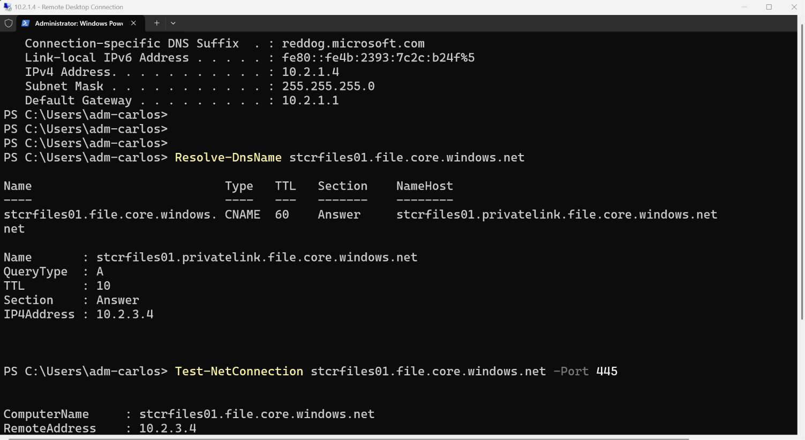

A side effect I didn't expect: the portal's **Browse** button now says "You don't have access." That's the private endpoint working. My laptop isn't inside the network, so even the portal can't reach the files.

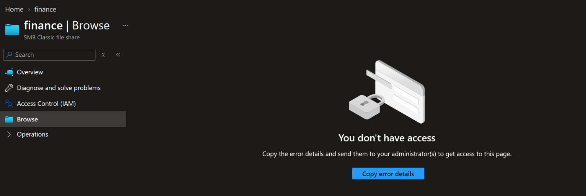

### Joining the storage to AD

Using Microsoft's AzFilesHybrid module, I joined the storage account to the domain as a computer account in the Servers OU. Now people sign into the shares with their normal domain account through Kerberos, with AES256 encryption (the `16` in the screenshot).

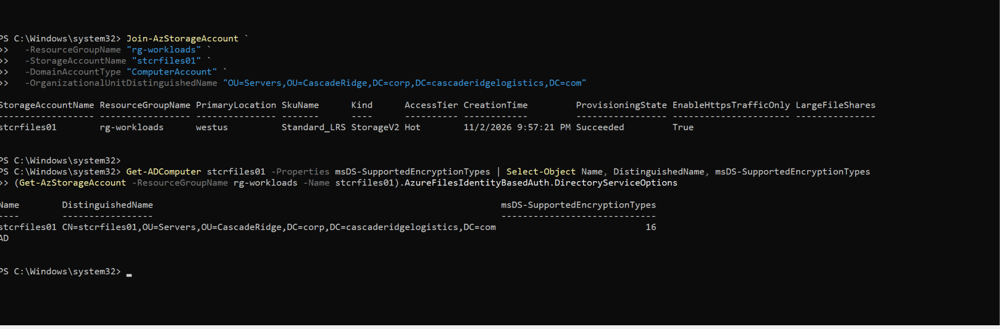

### Two locks on every share

Azure Files checks two permissions, and both have to say yes:

1. **Share level (Azure):** can you reach the share at all? For now every domain user can. I'll tighten this to per-department access after the Entra sync.
2. **NTFS (Windows):** what can you do with the files inside? This is where each department only gets its own share.

I set the NTFS permissions with a script, [scripts/Set-ShareAcls.ps1](../scripts/Set-ShareAcls.ps1). It removes the default "everyone can read" entries and gives each department group Modify on its own share. Public is the exception: everyone can read it, and only IT can change it.

On the first run, hr-dept showed an extra entry for adm-carlos alone. I removed it, because access should always go to groups, never to one person. When someone changes jobs you update their group, not a dozen folders.

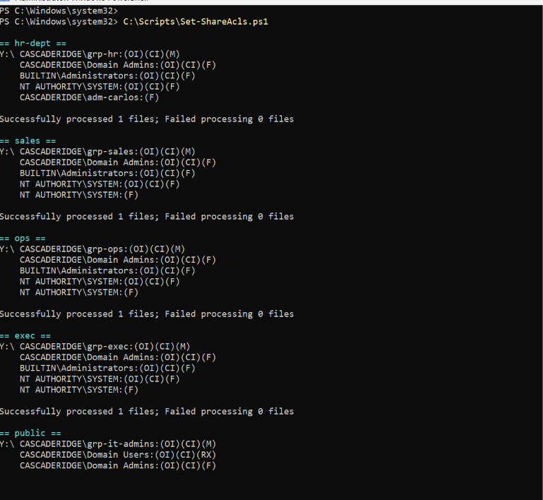

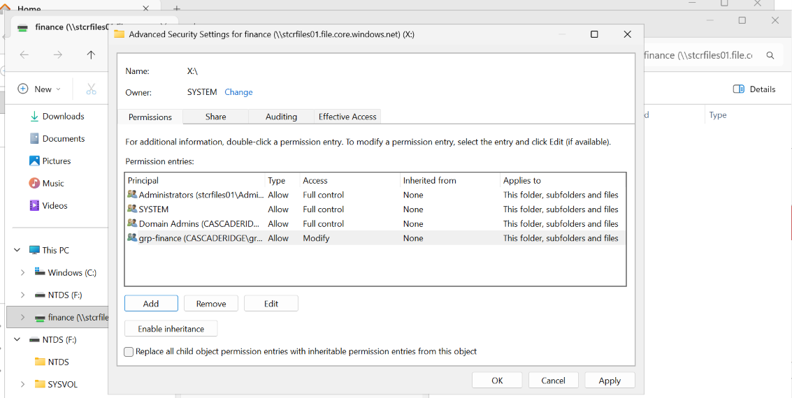

### Fake company data

Empty shares aren't much to protect or attack, so I wrote [scripts/New-CascadeRidgeData.ps1](../scripts/New-CascadeRidgeData.ps1) to fill them with realistic **fake** files: invoices, a payroll register, budgets, an employee roster, customer lists, shipment schedules, board notes, and a file called `Acquisition_Target_CONFIDENTIAL.txt` in the exec share that I'll use as bait later. Every name, company and number is made up.

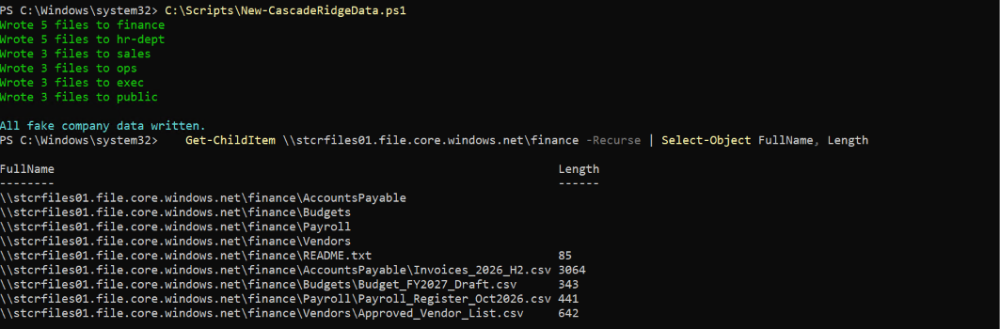

## Part 6: The first workstation and the real test

**vm-ws-fin01** is Marcus's computer in the Finance subnet (10.1.1.4). It's Windows Server standing in for Windows 11, since Windows 11 in Azure needs a license I don't have, and it behaves the same for the domain, Group Policy and LAPS.

Before the workstation could join, I opened the AD ports on the DC's NSG, only for the corp network (DNS 53, Kerberos 88 and 464, RPC 135 and 49152 to 65535, LDAP 389 and 636, SMB 445, Global Catalog 3268 and 3269). The firewall decides which networks can talk. The NSG decides which ports.

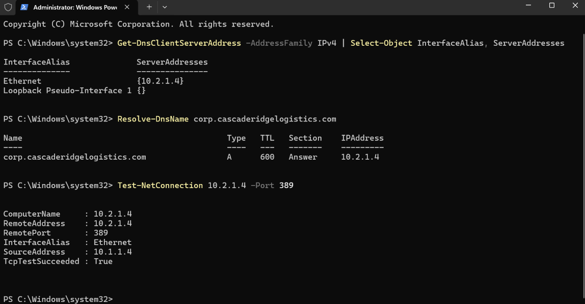

It joined the domain straight into the Workstations OU and pulled all four GPOs.

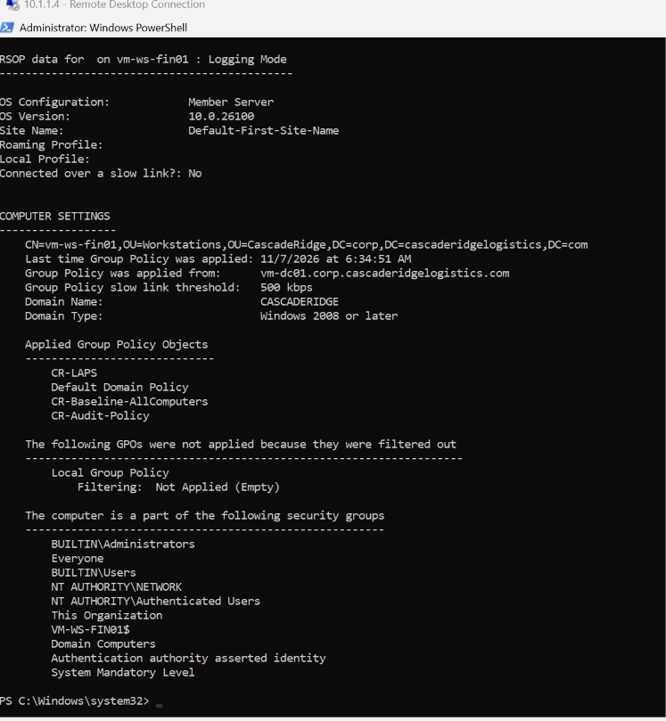

LAPS took over the local admin password right away. The password I typed when I built the VM doesn't work anymore.

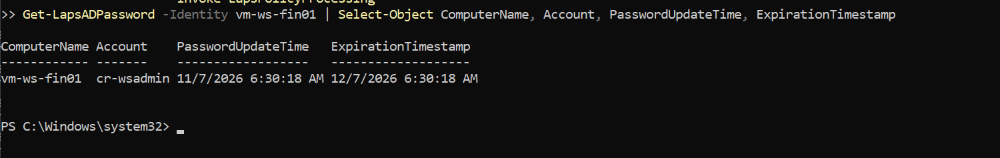

Then the test this whole phase was building toward. I signed in as Marcus (Finance):

* Finance share: **allowed**
* Public share: **allowed**
* A Kerberos ticket for the file share, which proves he got in with his own domain sign-in and not a storage key

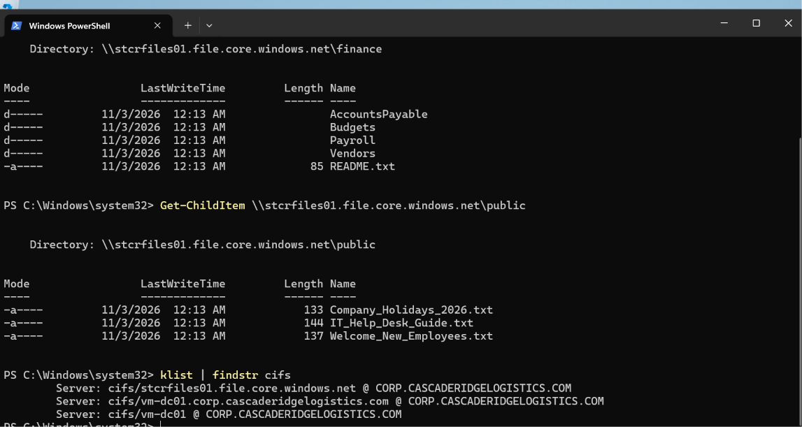

* HR share: **Access is denied**

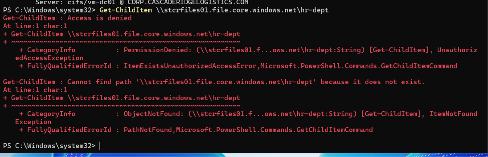

## Problems I hit

* **The cost estimator said $1,161 a month for the DC.** It's a preview feature and was wrong for that image. The real price on the Review + create page was $0.186 an hour.
* **The LAPS schema update needed Schema Admins.** I ran it as the built-in administrator with `runas`, and the outer shell swallowed `$false` from my command. Running it directly in that window fixed it.
* **Group Policy's Settings tab was blank.** Internet Explorer Enhanced Security blocks the page GPMC uses to show settings. I trusted only that one page instead of turning the protection off.
* **A share called "hr" failed, but my script said it worked.** Share names need at least 3 characters. I renamed it to hr-dept and changed the script to stop and report real errors.
* **My ACL script couldn't see the drive it had just mapped.** A PowerShell drive is invisible to other programs like icacls unless you map it with `-Persist`.
* **Marcus couldn't RDP in with "must change password at next sign-in."** RDP checks credentials before the desktop loads, so there's no screen to change the password on. I set his password directly for the test.

## What's next

* Build the Sales workstation and test Tom the same way
* Sync AD to Entra ID with Cloud Sync, so the on-prem accounts and cloud accounts are the same people
* Replace the "every domain user" share permission with per-department permissions

## Key takeaway

Least privilege only means something once you prove the "no." Seeing Marcus open Finance was nice, but seeing him get Access Denied on HR is what showed every layer (DNS, the firewall, NSGs, Kerberos, share permissions and NTFS) was doing its job.
