# Phase 5: Website, Email, Key Vault and the CRM

**Dates:** Nov 13 to Nov 19, 2026
**Goal:** Give the company the things a real business runs on: a public website, real email that can't be spoofed, a safe place for secrets, and an internal app with customer data.

[Back to README](../README.md) | [Previous: Phase 4](phase-4-active-directory.md)

In plain terms: Cascade Ridge Logistics now has a website on its own domain, working company email, a locked vault for passwords, and an internal CRM that employees use to look up customers and shipments. Everything is still fake data, and everything is built secure first.

## Part 1: The company website

I wanted the company to have a public face, both because real companies do and because in Phase 8 it's the first thing an attacker would research. It's a simple one-page site, clearly marked as a fictional company for a cybersecurity lab, so nobody mistakes it for a real business.

* Hosted on **Azure Static Web Apps** (free tier). There's no server for me to patch, and Azure handles HTTPS certificates.
* Uploaded from Cloud Shell with Microsoft's Static Web Apps tool, using a deployment token.
* Locked down with **security headers** in a config file: no scripts are allowed to run, the page can't be framed by another site (clickjacking), browsers must use HTTPS, and the page can't ask for the camera, microphone or location.

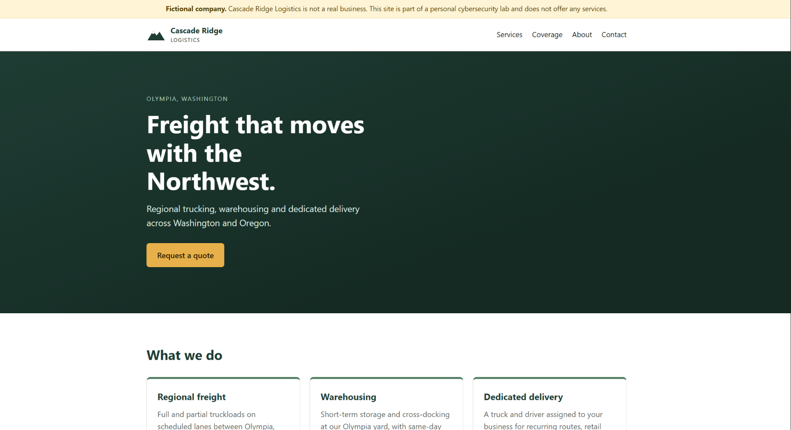

### Putting it on the real domain

The site started on a random Microsoft address. To put it on `cascaderidgelogistics.com`:

* **www:** a CNAME record at my DNS host pointing to the Static Web App.
* **The bare domain:** Azure first made me prove I own it with a TXT record, then I pointed the domain's ALIAS record at the site.

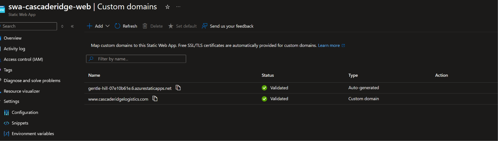

I also deleted a wildcard record my registrar adds by default. It made every made-up subdomain resolve to a parking page. Fewer names that resolve means less for an attacker to probe.

## Part 2: Email that can't be spoofed

Anyone can send an email that *claims* to be from any domain. Three DNS records are how receiving mail servers tell real mail from fakes.

| Record | Plain meaning |
|---|---|
| **SPF** | Which servers are allowed to send email as us |
| **DKIM** | A digital signature on every email, proving it came from us and wasn't changed on the way |
| **DMARC** | What to do with mail that fails: I set it to **reject** |

### Locking the domain first

Before the company sent any email, I locked the domain down completely: SPF said nobody may send as us, and DMARC said reject anything that fails. A domain that sends no mail should always be locked like this. Attackers love forgotten domains.

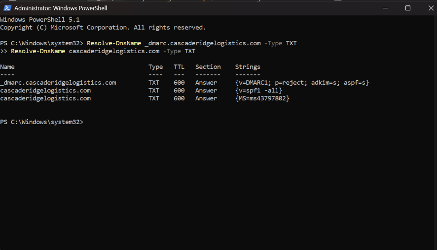

### Turning on real email

I started a Microsoft 365 Business Premium trial (the plan most small companies actually buy) and gave the six employees mailboxes. They're the same accounts synced from Active Directory in Phase 4.

The admin accounts got **no mailbox on purpose**. Email is the number one way attackers get in, and an account that can't receive email can't be phished through it.

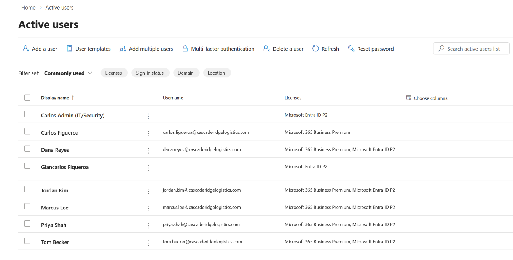

Then I pointed the domain's mail records at Microsoft: the MX record (where incoming mail goes), SPF (now "only Microsoft can send as us," still strict), and autodiscover for Outlook setup.

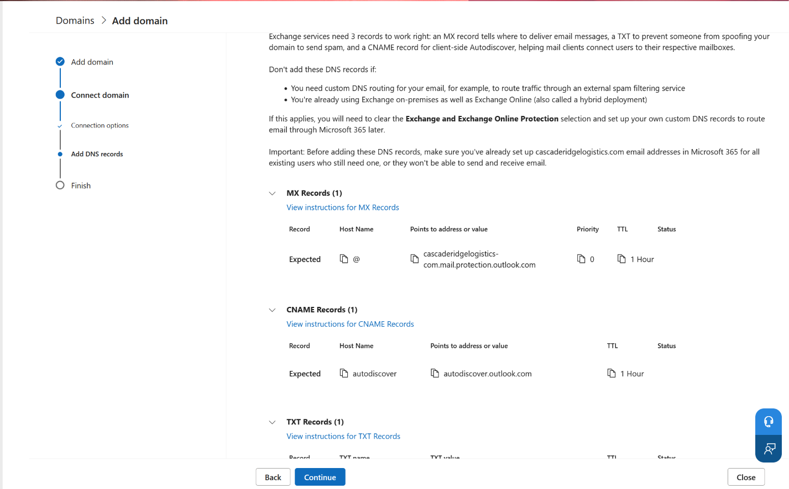

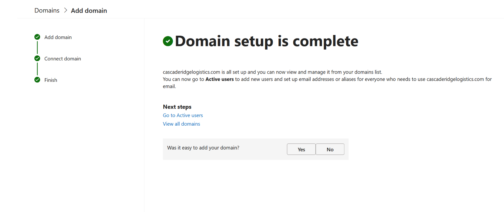

### DKIM

The first time I tried to create DKIM keys, Microsoft said the tenant wasn't licensed for Exchange. A brand-new trial takes a while to finish setting up behind the scenes. A few days later it worked: I created the keys, added the two DKIM records, and turned signing on.

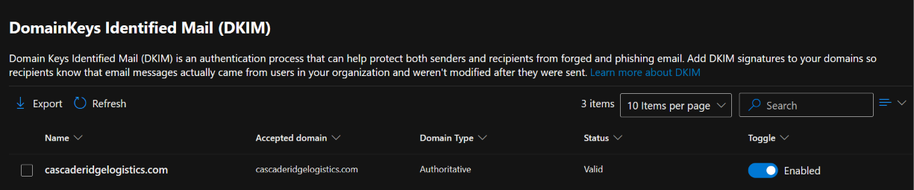

### Proving it works

I signed in as Marcus (who had to set up MFA on first sign-in, since my Conditional Access policy requires it) and emailed my personal Gmail. Gmail's "Show original" view is what an analyst checks during a phishing investigation, and all three checks passed.

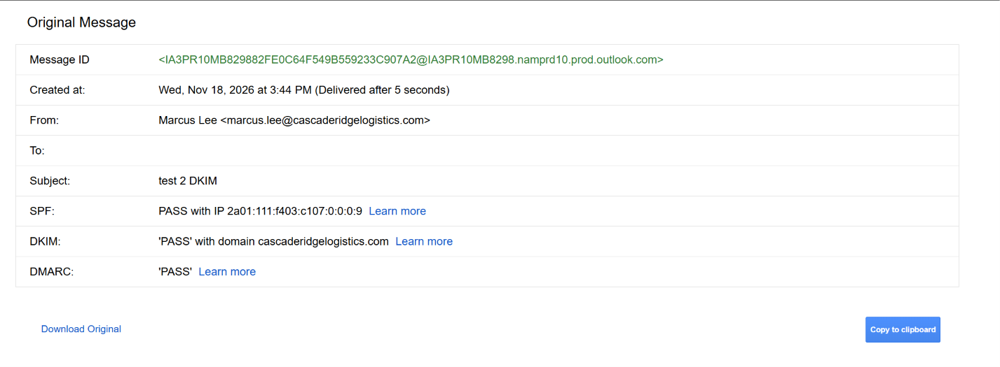

The full headers also show the path the message took, that it was encrypted between Microsoft and Google, and Microsoft's spam score. Reading those headers bottom to top is a core SOC skill.

## Part 3: Key Vault

Up to now, passwords and keys lived in scripts and in my head. **Azure Key Vault** is a locked safe for secrets.

* **No public access.** It has a private endpoint at 10.2.3.5, so only machines inside my network can reach it, the same pattern as the file shares in Phase 4.
* **Access through Entra roles.** Being the subscription Owner lets me manage the vault, but **not** read the secrets inside it. I had to give my admin account a separate role (Key Vault Secrets Officer) on this vault only.
* **Soft delete,** so a deleted secret can still be recovered.

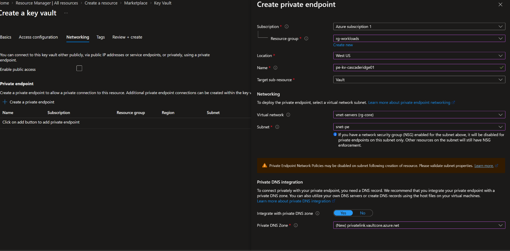

The setup wizard created the private DNS zone but skipped the record and the network link, so machines would have looked up the vault's public address and been refused. I added them by hand.

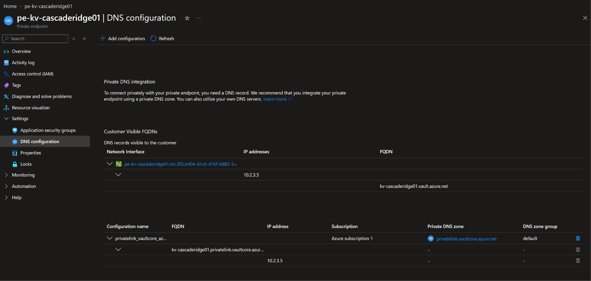

The subnet's NSG also needed an HTTPS rule. The portal suggested priority 4010, which would have put it **below** my deny rule at 4000, so it would never have taken effect. I used 130.

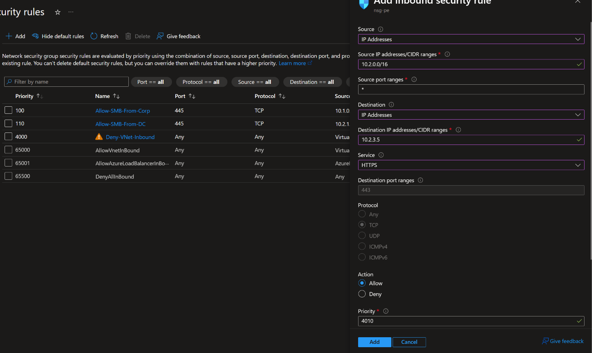

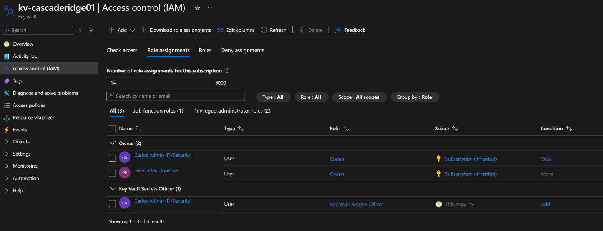

From the domain controller I stored and read a test secret. From my laptop, the portal refuses, because my laptop is outside the network.

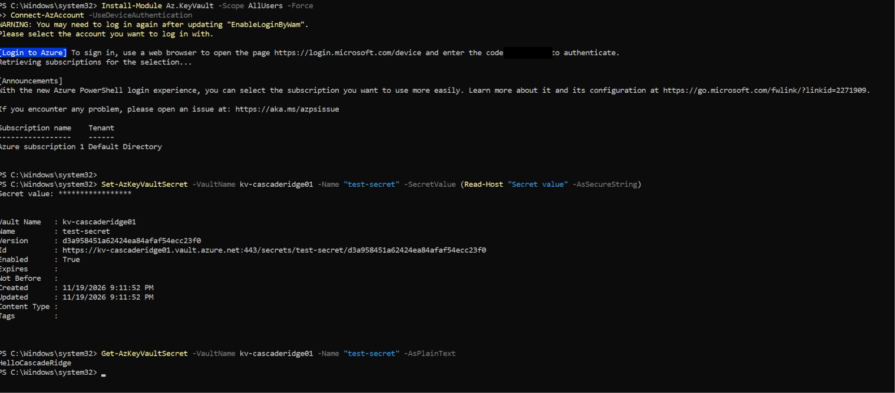

## Part 4: The internal CRM

The last piece is an internal app employees actually use: a CRM with the company's (fake) customers and shipments.

**vm-crm01** is an Ubuntu server in the apps subnet (10.2.2.4) with no public IP. I sign in with an SSH key instead of a password, so there's nothing to guess.

### No passwords on the server

The CRM needs a database password. The usual mistake is putting it in a config file, where anyone who breaks in can read it. Instead:

1. I generated a random 32-character password on the domain controller and put it **straight into Key Vault**. No person has ever seen it.
2. The server got a **managed identity**, its own account in Entra.
3. I gave that identity **read access to that one secret only**, not the whole vault.

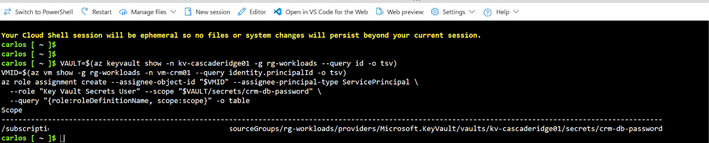

### Network rules

Only my VPN address can SSH in, and only employee workstations can open the website.

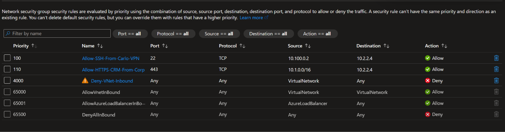

The first time I connected, the server couldn't look anything up or download updates. The servers network uses the domain controller for DNS, and the DC's NSG only allowed the workstations. One rule allowing DNS (and only DNS) from the apps subnet fixed it.

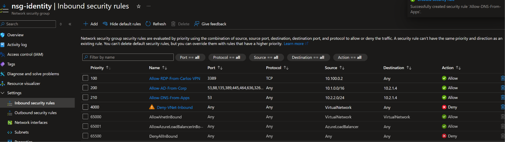

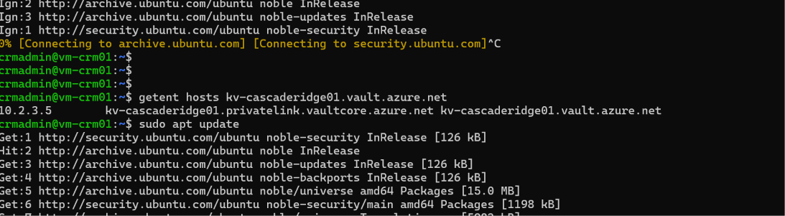

### Proving least privilege

From the server, using only its managed identity, I asked the vault for two secrets. It got its own database password, and was **refused** (403) on the test secret it was never given. If anyone ever takes over this server, that one password is all they get from the vault.

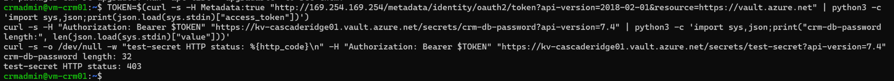

### Installing the app

I wrote an install script ([scripts/crm/setup-crm.sh](../scripts/crm/setup-crm.sh)) that:

* installs PostgreSQL, a small Python web app and nginx
* reads the database password from Key Vault and never writes it to disk
* loads fake data: the same 10 customers as the Sales share, plus 40 shipments
* runs the app as its own locked-down service account
* serves it over HTTPS with security headers
* turns on Ubuntu's host firewall as a second lock behind the NSG

The app only ever uses parameterized database queries, so input can't be turned into SQL commands.

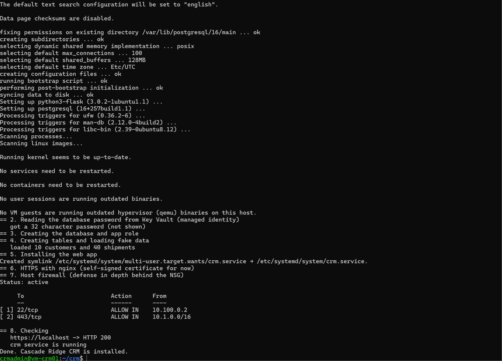

I added `crm.corp.cascaderidgelogistics.com` to the company DNS so employees can use a name instead of an IP.

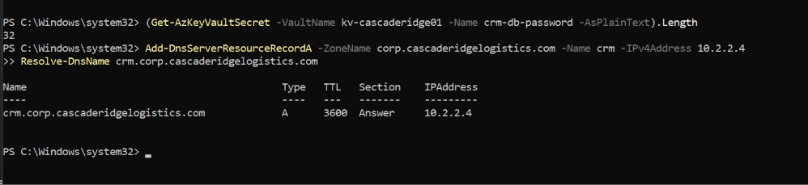

Then I signed in to the Finance workstation as Marcus and opened it.

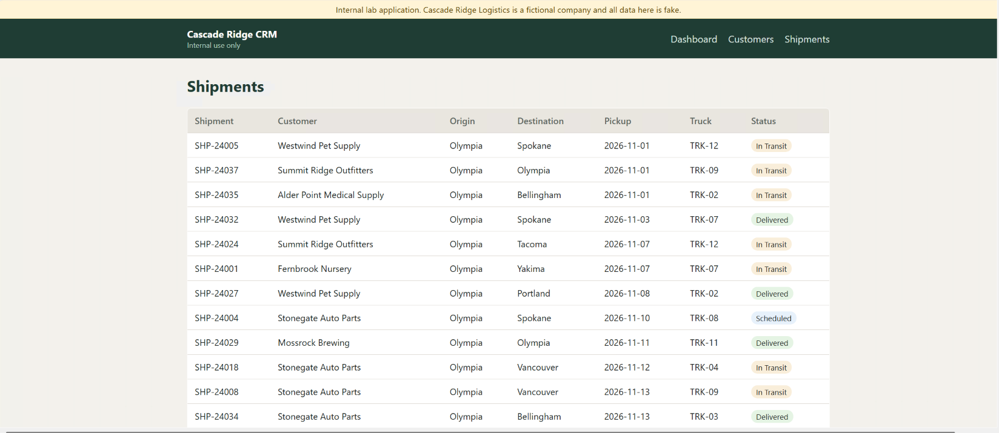

## Problems I hit

* **DKIM wouldn't turn on at first.** A new Microsoft 365 trial needs time before Exchange is fully set up. Waiting fixed it.
* **The Key Vault DNS link was missing.** The wizard made the zone but no record or link. The fix was the private endpoint's DNS configuration page, with the link's resource group set to where my VNets live.
* **The portal's default NSG priority would have been useless.** Rules below 4000 lose to my deny rule. Always check the number.
* **A multi-line paste over RDP got scrambled** and glued part of an old command into a new one. I overwrote the secret with a clean one-line command, and Key Vault kept the old version as history.
* **The CRM server couldn't use DNS.** The DC's NSG only expected workstations. Least privilege means remembering every system that needs a service.
* **SSH refused my key** because Windows let every account on my PC read the file. Locking it to just my account fixed it.

## What's next

Phase 6: security monitoring. Sentinel will collect logs from the DC, workstations, firewall, Key Vault and email, so I can start hunting with KQL.

## Key takeaway

The best secret is one nobody knows. The CRM's database password was created by a script, stored in a vault nobody on the internet can reach, and read only by the one server that needs it, using an identity instead of a password.
