# Phase 6: Security Monitoring and Vulnerability Scanning

**Dates:** Nov 24 to Nov 25, 2026
**Goal:** Be able to see what's happening in the company, find weaknesses before an attacker does, and prove my alerts actually fire.

[Back to README](../README.md) | [Previous: Phase 5](phase-5-workloads.md)

In plain terms: every important log in the company now flows into Microsoft Sentinel, Defender for Cloud grades how secure the Azure setup is, a Nessus scanner checks every machine from the inside, and I built alerts and tested them by locking out an employee's account on purpose.

This phase had four parts:

1. Collect the logs (Log Analytics and Sentinel)
2. Grade the cloud setup (Defender for Cloud)
3. Scan for vulnerabilities, fix them and rescan (Nessus)
4. Build detections and prove they work

## Part 1: Collecting the logs

### The workspace and a cost cap

Logs need somewhere to live, so I created a **Log Analytics workspace** (law-cascaderidge). Before sending anything to it, I set a **daily cap of 0.5 GB**. If something ever floods the workspace with logs, collection stops for the day instead of running up a bill. My lab sends far less than that.

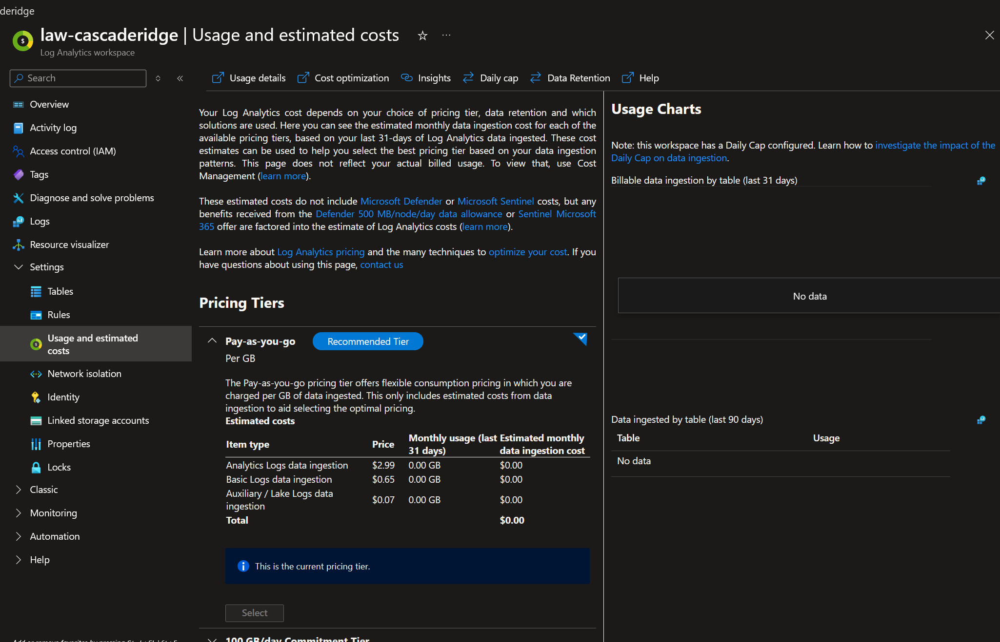

### Turning on Sentinel

**Microsoft Sentinel** is the SIEM. It sits on top of the workspace, searches the logs and turns suspicious activity into incidents. New workspaces get a 31-day free trial with up to 10 GB a day free.

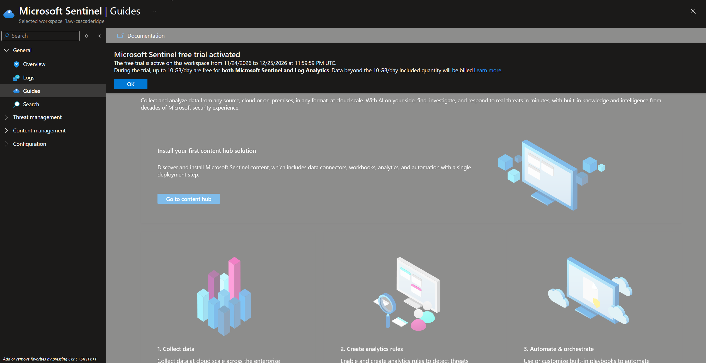

In Sentinel, data sources come as **solutions** from the Content hub. Installing one adds its connector plus detection rule templates and saved searches. Nothing runs until you turn it on, so installing is safe.

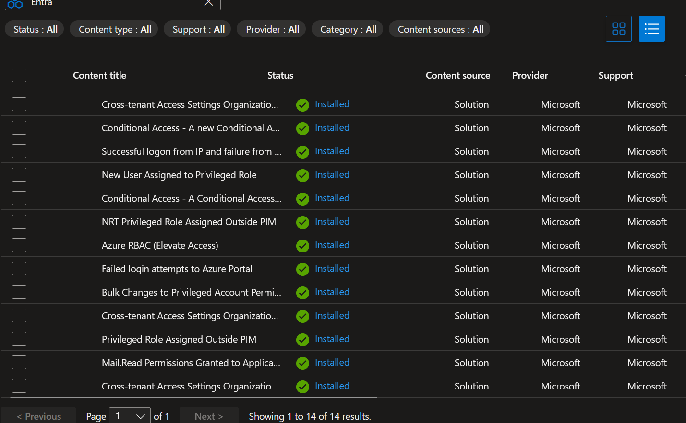

### Cloud logs: Entra ID and Azure Activity

* **Entra ID:** sign-in logs (who signed in, from where, MFA, blocked attempts) and audit logs (admin changes like role and group changes). I only picked those two, because the other types are noisy for a small lab.
* **Azure Activity:** every change made in Azure, like a VM started or an NSG rule edited. This one connects through an **Azure Policy** at the subscription level, with its own managed identity to apply the setting.

The Entra ID connector first said **"No permissions."** My admin account is only *eligible* for Global Administrator through PIM, so I had to activate the role first. That's PIM doing its job.

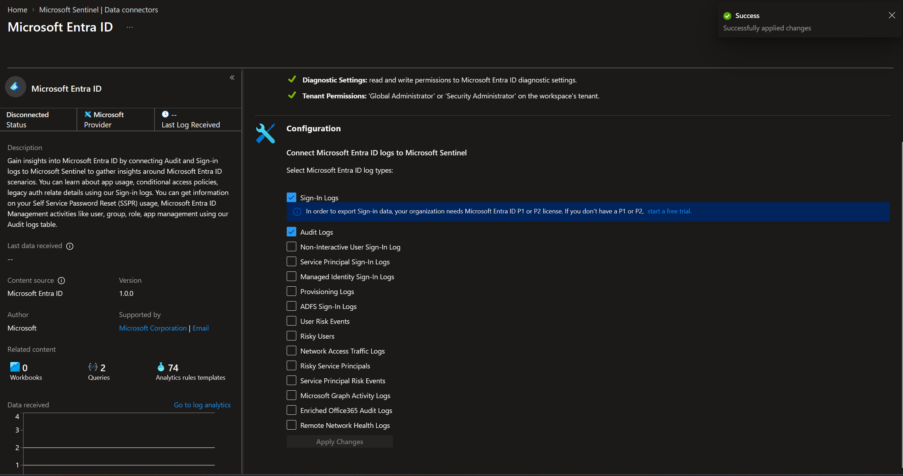

### Windows logs from the DC and workstations

The **Azure Monitor Agent** runs on each Windows VM and sends Security events to Sentinel. A **data collection rule** decides which events. I picked the **Common** set, which is what most companies use: it keeps the useful events without everything.

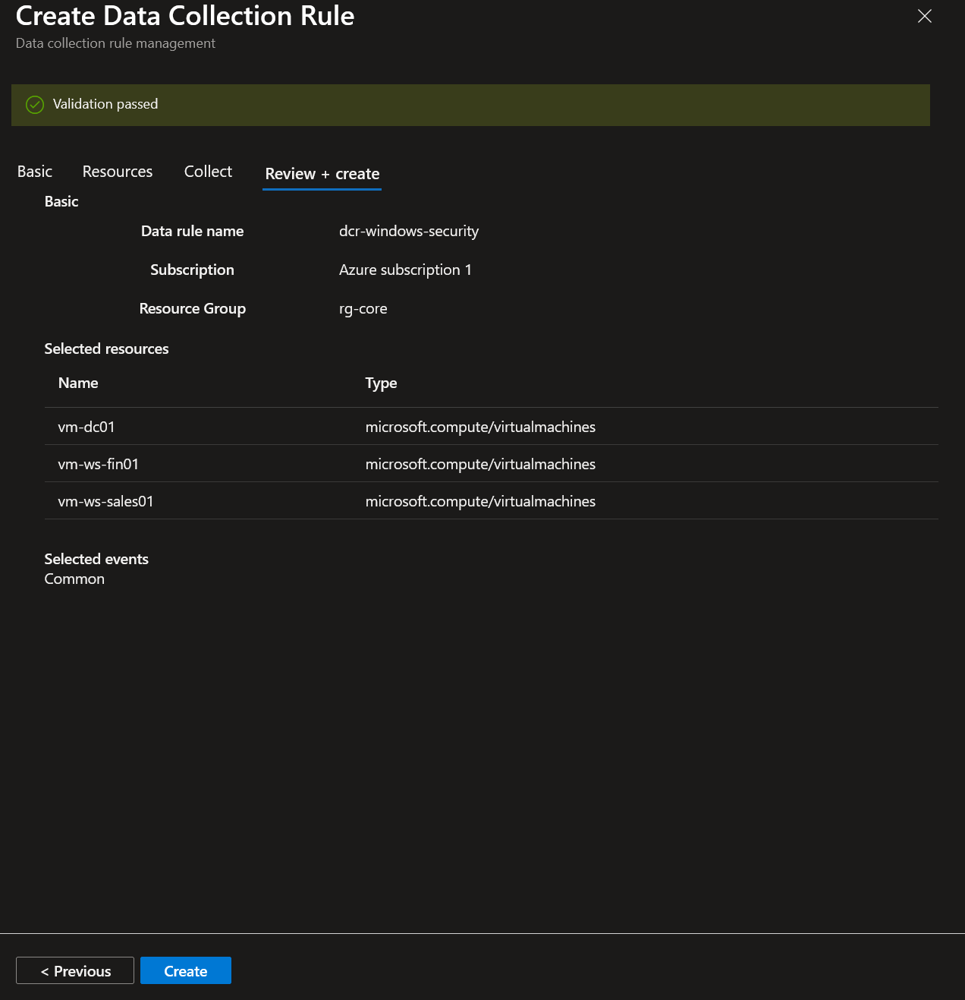

The wizard installed the agent on each VM for me.

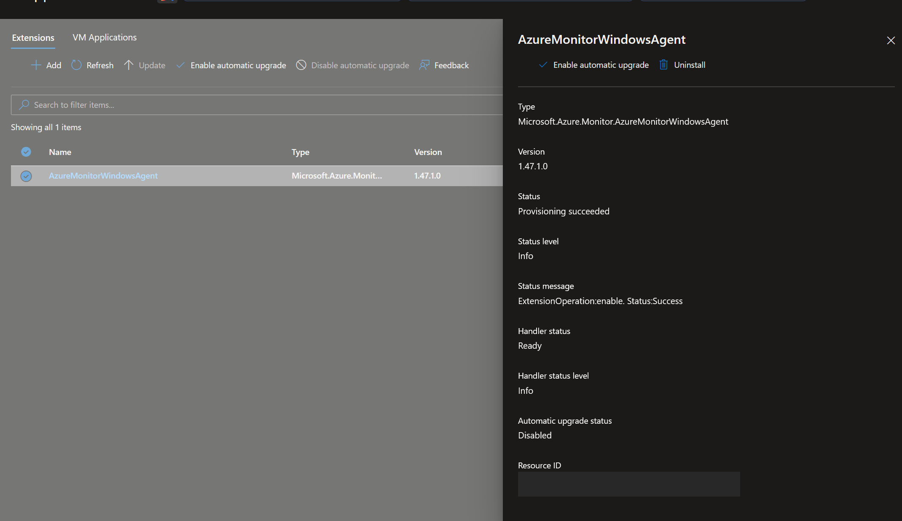

Within minutes I could see logons (4624), process creation with command lines (4688) and admin logons (4672) from all three machines. The audit policy I set up by hand in Phase 4 is what makes these events exist.

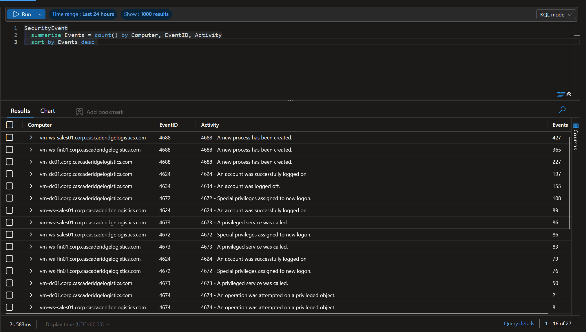

### Linux logs from the CRM

Linux writes to **syslog** instead of an event log. I collected the login and sudo facilities (auth and authpriv) at info level, plus firewall and service warnings.

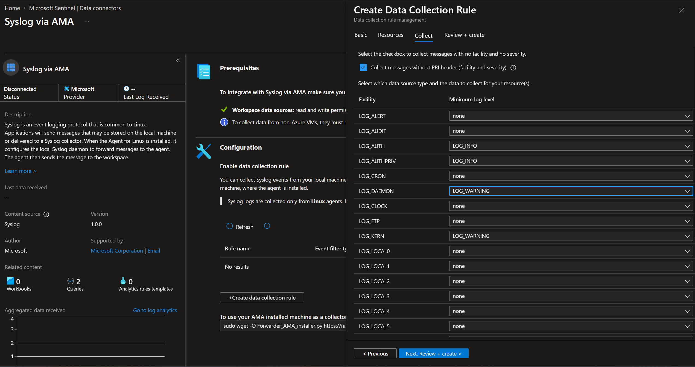

My SSH key login showed up right away.

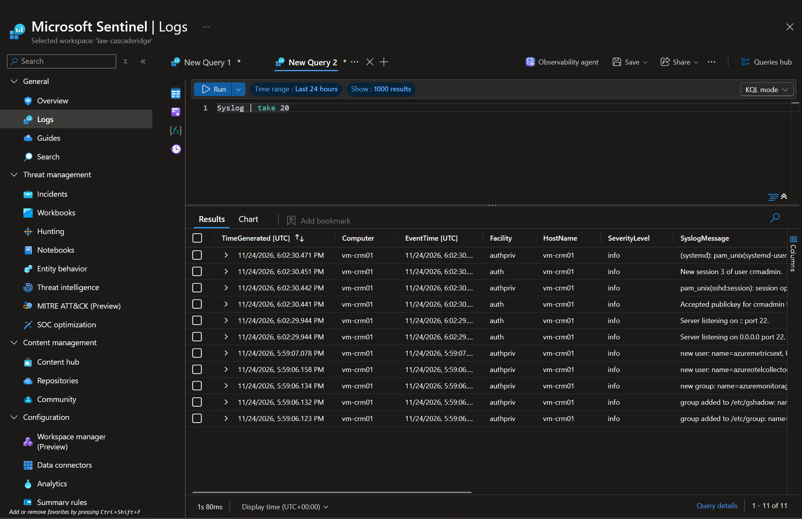

### Checking everything at once

One query to confirm all five sources were sending data:

```kql
union SecurityEvent, Syslog, SigninLogs, AuditLogs, AzureActivity
| summarize Rows = count(), Latest = max(TimeGenerated) by Type
```

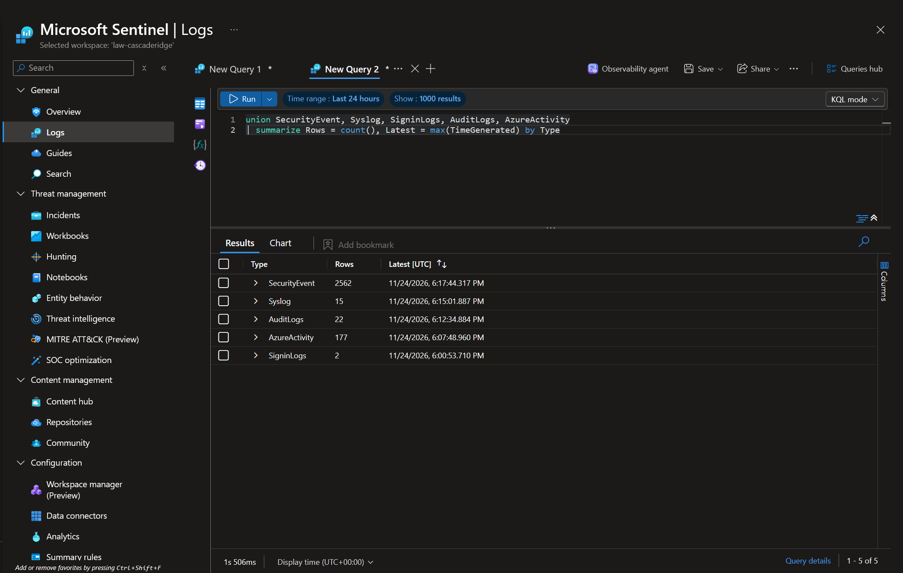

## Part 2: Grading the cloud setup with Defender for Cloud

Defender for Cloud's free tier checks how Azure is configured and gives a **secure score** with recommendations. The paid plans add a lot, but turning them all on would cost over $120 a month, more than my whole lab. I kept only the free tier, and I can explain that trade-off.

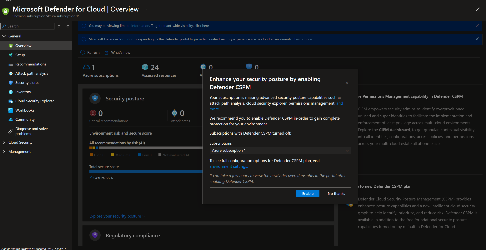

My score started at 55% with 41 recommendations. That sounds bad, but they were really only 13 issues repeated across VMs. I exported them and sorted every one:

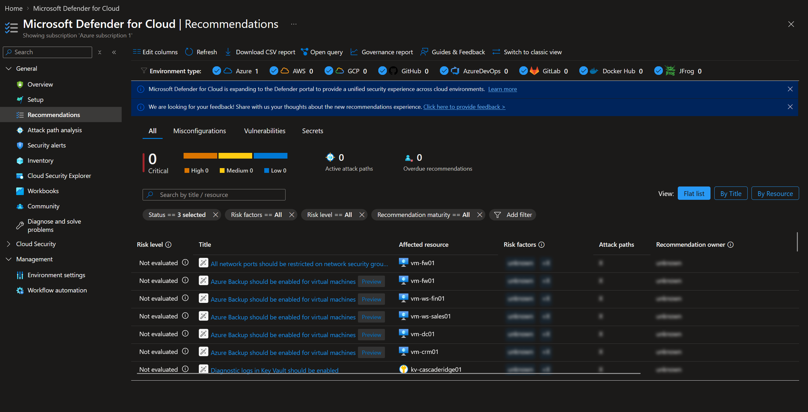

| Decision | Recommendation | Reason |
|---|---|---|
| **Fixed** | Security contact and alert emails | Free. Serious alerts now get emailed to me |
| **Fixed** | Key Vault diagnostic logs | Free. Every secret read now goes to Sentinel |
| **Fixed** | Check VMs for missing updates | Free with Azure Update Manager |
| **Accepted** | Open port on the firewall | That's WireGuard. It ignores any packet without a known key |
| **Accepted** | IP forwarding on the firewall | Forwarding traffic is the firewall's whole job |
| **Accepted** | Azure Backup on all VMs | Costs money. My recovery plan is rebuilding from code later |
| **Accepted** | Paid Defender plans | Over $120 a month |
| **Accepted** | Storage shared key access | My share permission script uses the storage key |
| **Optional** | Encryption at host, guest extensions | Free but low value for a lab. Azure disks are already encrypted |

Writing down *why* a risk is accepted is part of the job. A finding you can't fix still needs a decision and a reason.

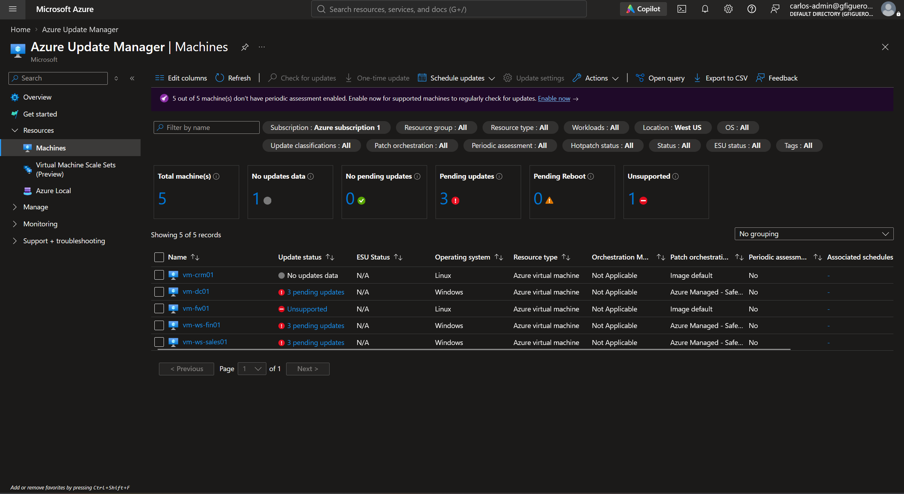

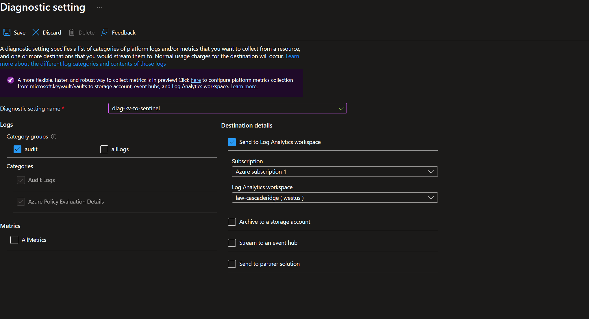

## Part 3: Vulnerability scanning with Nessus

I did Tenable scans in my internship, but this time I built the scanner myself inside my own network, which is how most companies run it.

### Building the scanner

* **vm-scan01:** Ubuntu, 2 vCPU, 8 GB of RAM (Nessus needs the memory to compile its plugins), no public IP, SSH key only.
* It sits in the **management subnet** (10.0.2.4), which the firewall already lets reach every spoke.
* Its NSG only allows SSH and the Nessus web page (port 8834) from my VPN.

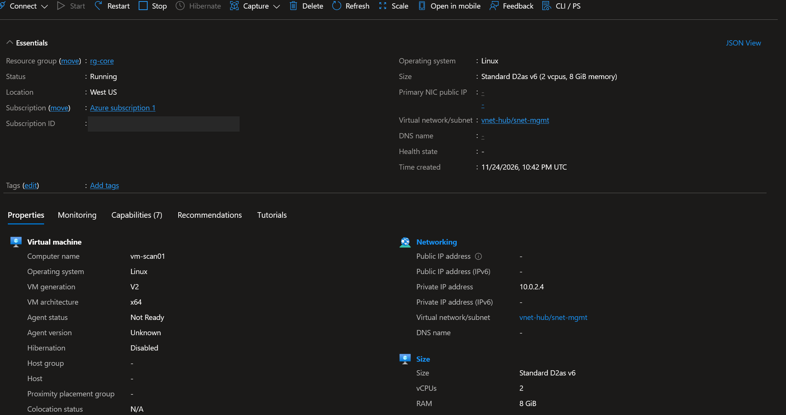

I had two roadblocks before I could even build it:

* **vCPU quota.** My subscription could only run 10 vCPUs in West US and I was using all 10. The quota page said I didn't have permission even though I'm Owner, so I filed a free support request instead. It was approved in minutes and the limit is now 20.
* **DNS.** The scanner uses the DC for DNS, and the DC's NSG didn't know about it. I added a DNS-only rule for the scanner's IP.

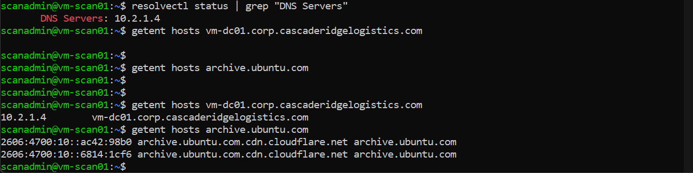

Then I installed **Nessus Essentials** (the free version, up to 16 IPs) and activated it.

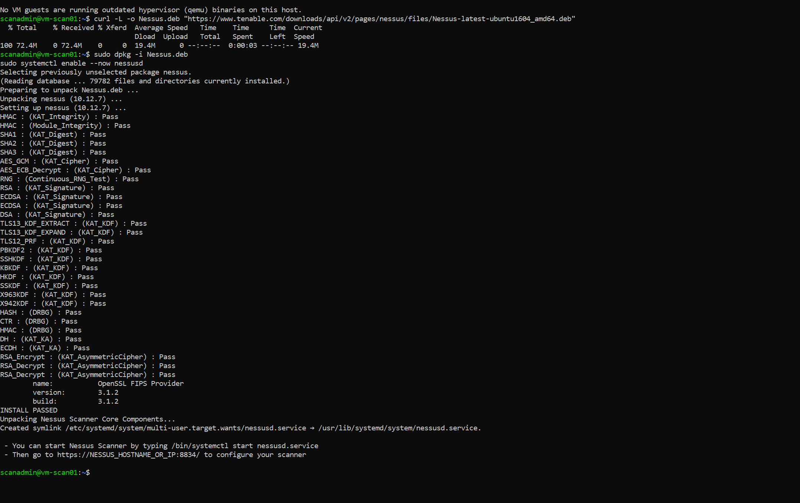

### Giving the scanner a way in

A **credentialed scan** logs in to each machine, so it can check installed updates and settings from the inside instead of only looking at open ports like an attacker would. That means the scanner needs admin access, so I set it up carefully:

* **A dedicated account, svc-nessus,** used only by the scanner and never by a person. In the logs, I always know which logins are the scanner.
* **A group, grp-vuln-scanners,** so the access is easy to review and remove later.
* **Not synced to Entra.** It lives in the Service Accounts OU, which Cloud Sync ignores.

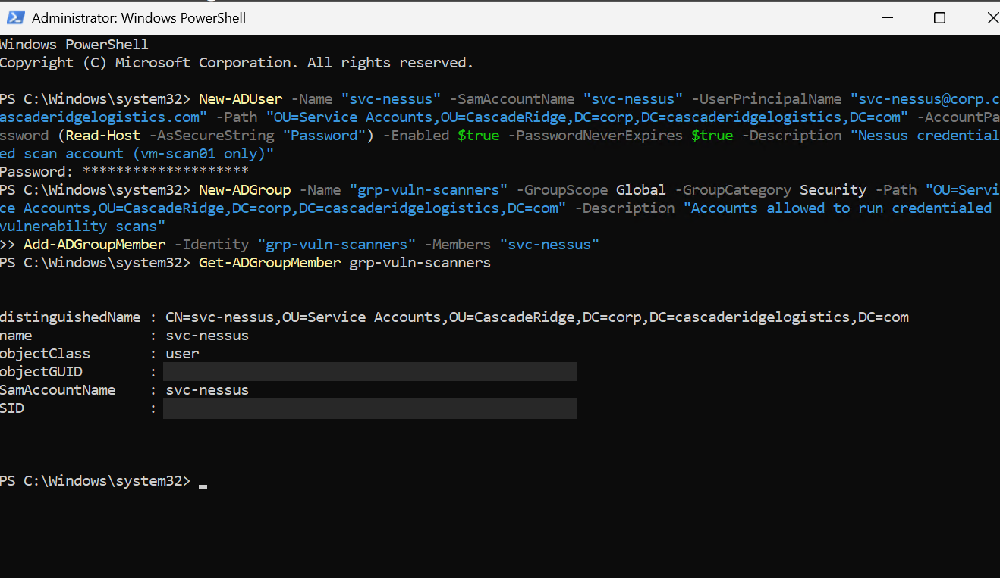

**On the workstations,** a GPO called CR-Vuln-Scan-Access adds the group to the local Administrators group and opens the Windows firewall to the scanner's IP **only** (file sharing and remote management ports).

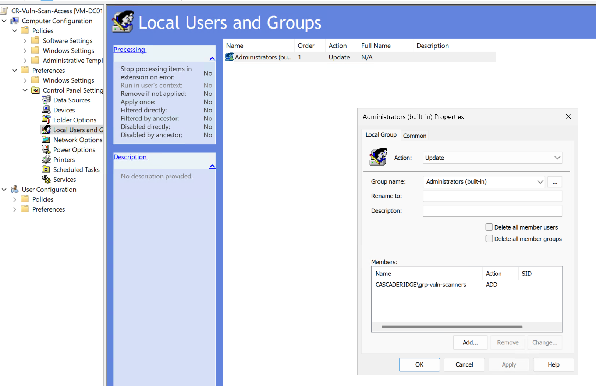

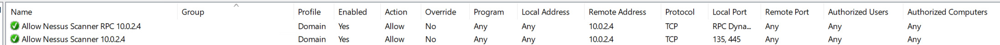

**On the DC,** I added the group to the domain's Administrators group, since scanning a DC with credentials requires it. That list is short on purpose.

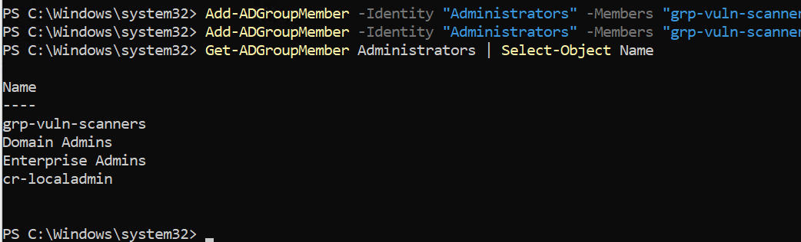

**In Azure,** each target's NSG needed a rule letting the scanner in. I wrote a script so all four rules are created the same way, with the scanner's IP as the only source. It's in [scripts/add-scanner-nsg-rules.sh](../scripts/add-scanner-nsg-rules.sh).

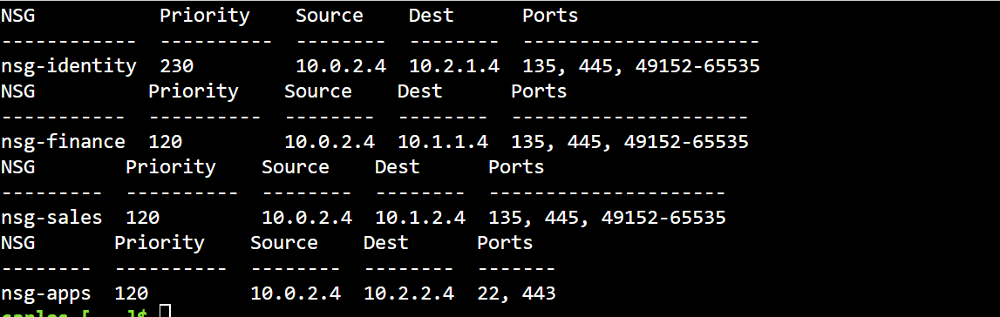

**On the CRM (Linux),** svc-nessus logs in with its own SSH key, and the key only works when the login comes from the scanner's IP (`from="10.0.2.4"` in the authorized keys file). It can use sudo to become root for the scan, and the CRM's own firewall (ufw) allows the scanner on SSH and HTTPS only.

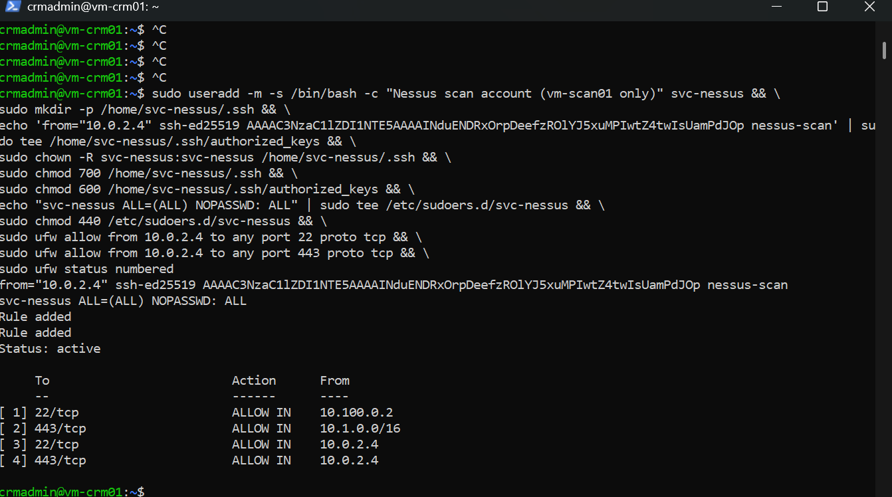

In Nessus I gave the scan both logins. I turned off "ping the remote host" during discovery, because my NSGs block ping and Nessus would otherwise think the machines were off.

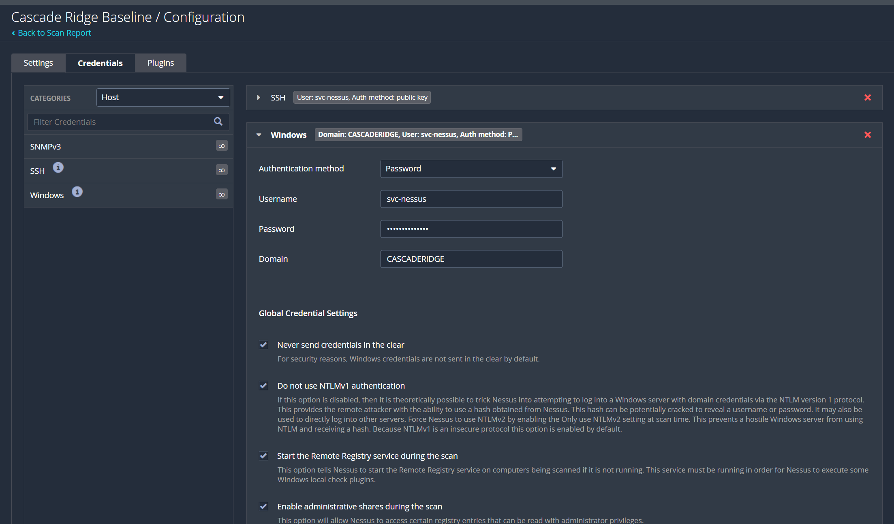

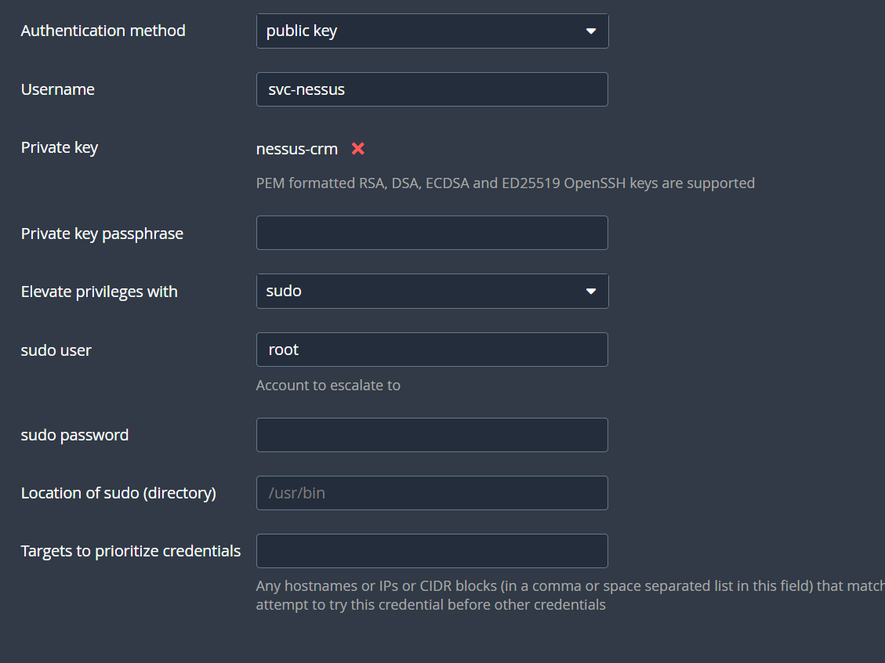

### The first scan

All four machines showed **Auth: Pass**, so every login worked and it was a full credentialed scan.

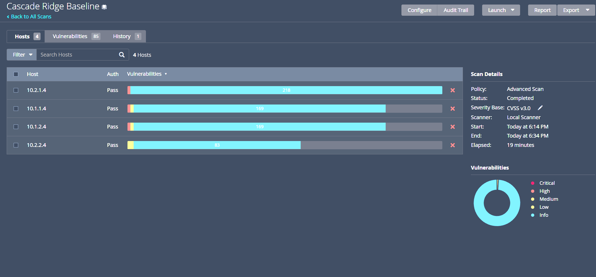

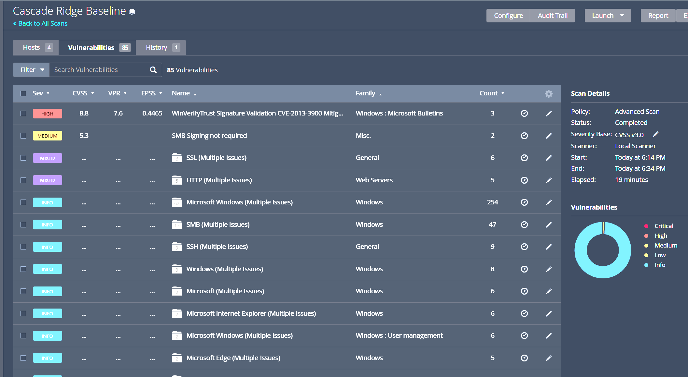

| Finding | Severity | Where |
|---|---|---|
| WinVerifyTrust signature check (CVE-2013-3900) | High | DC and both workstations |
| SMB signing not required | Medium | Both workstations |
| HSTS missing on the HTTPS site | Medium | CRM |
| Self-signed certificate | Medium | CRM |

**0 Critical.** Everything else was Info, which is inventory like OS version and open ports. For comparison, the purposely vulnerable VM in my internship had 45 findings on its first scan, including 5 Critical. Building secure from the start shows up in the numbers.

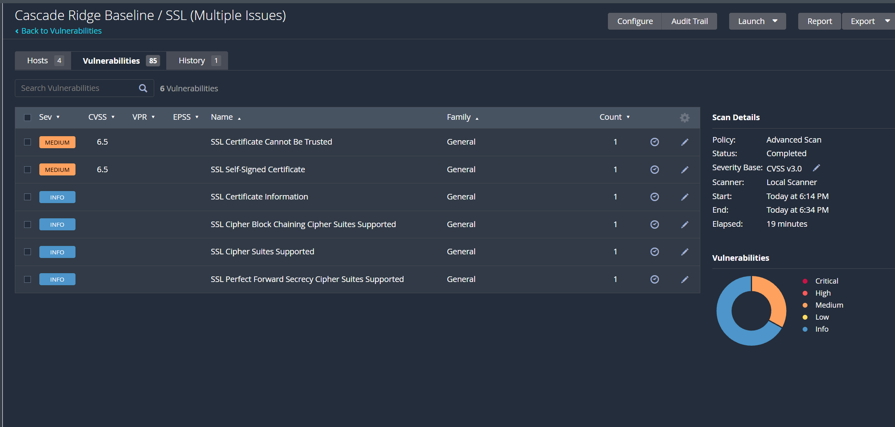

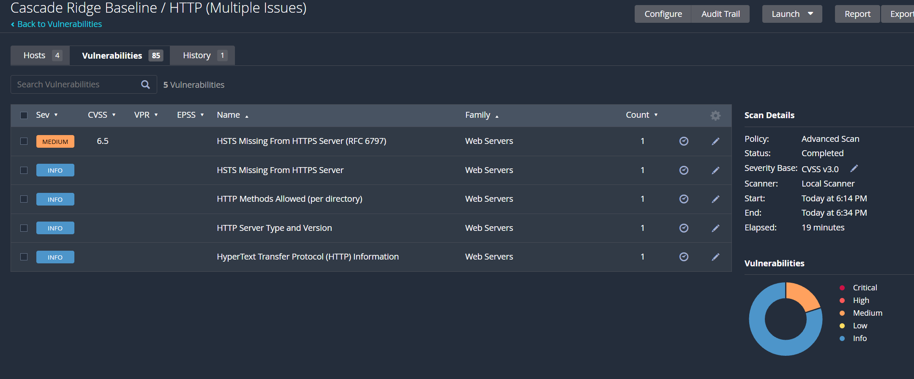

### What CVE-2013-3900 is

Windows checks digital signatures to decide if a program is genuine. The flaw is that the signature doesn't cover every part of the file, so an attacker can hide extra code in the unchecked part of a real signed file and Windows still says it's valid. This was used in the 3CX supply chain attack in 2023. Microsoft shipped the fix **turned off** so it wouldn't break old installers, and you have to turn it on with a registry setting. That's why almost every Windows scan flags it.

### The fixes

**Windows (one GPO for the whole domain).** I added these to CR-Baseline-AllComputers, which is linked at the domain root:

* **SMB signing:** "Digitally sign communications (always)" for both server and client, so file sharing traffic can't be tampered with on the way.
* **CVE-2013-3900:** `EnableCertPaddingCheck = 1` in both the 64-bit and 32-bit Wintrust registry paths, so Windows uses the strict signature check.

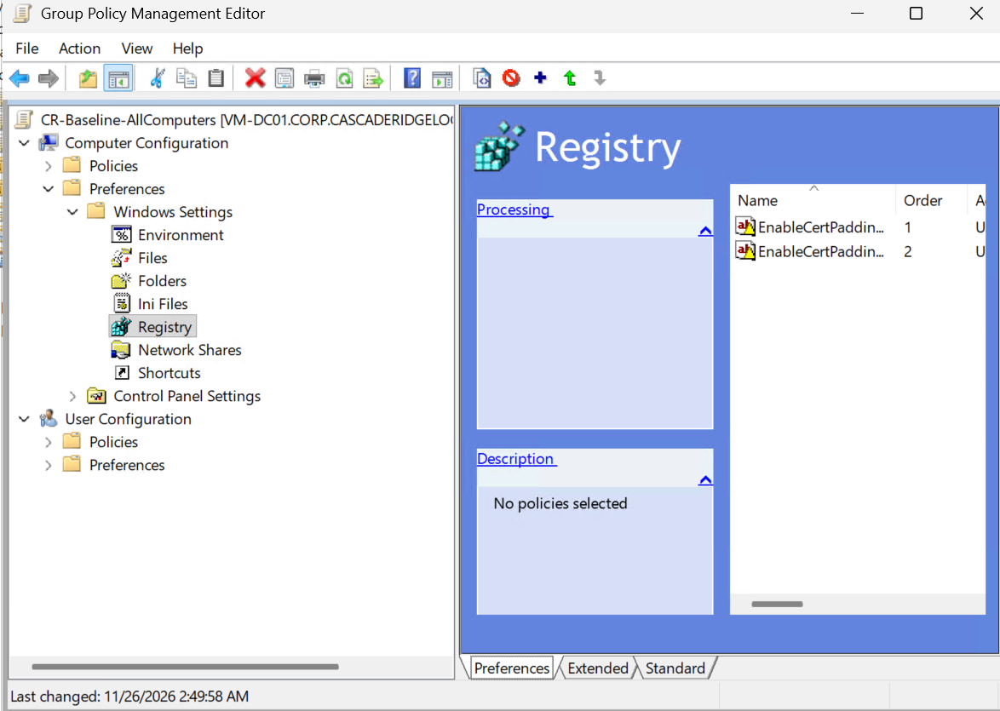

**CRM.** I added the **HSTS** header to nginx, which tells browsers to only ever use HTTPS with the site. I tested the config before reloading, then confirmed the header was being sent. The setup script now includes it too.

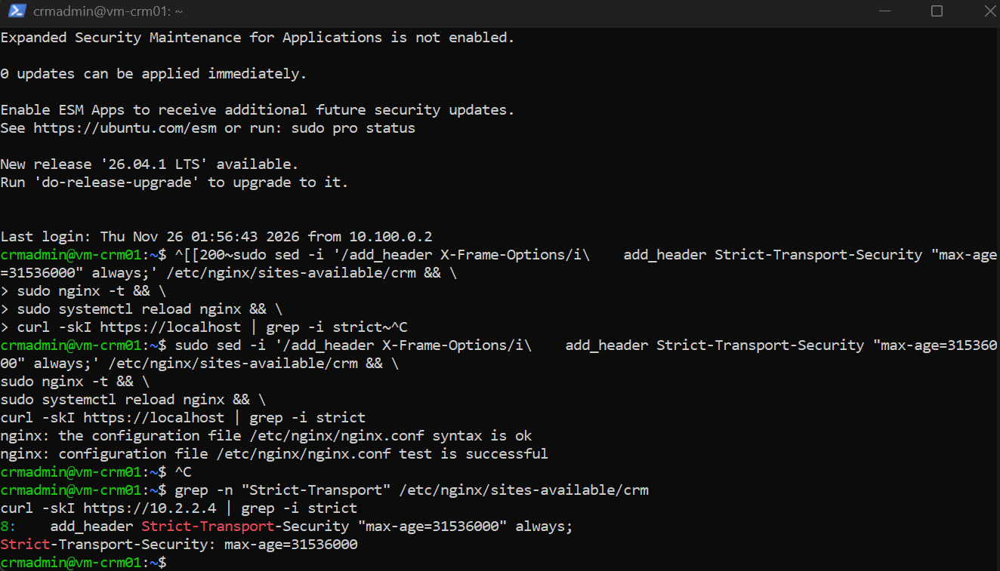

**Accepted:** the CRM's self-signed certificate. It's an internal app only reachable inside the network. The right fix is an internal certificate authority that every company computer trusts, which I plan to add later.

### The rescan

All three Windows machines came back with **Info only**. The only thing left on the CRM is the self-signed certificate I accepted. That's the full vulnerability management cycle: scan, sort, fix, accept with a reason, and rescan to prove it.

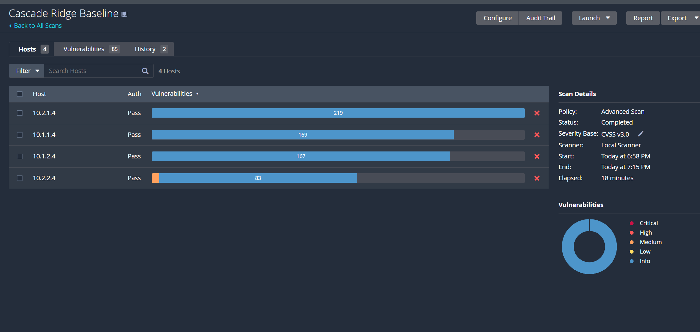

## Part 4: Proving the detections work

### Checking the logs with KQL

Before building alerts, I made sure the events I care about were actually arriving. The scans gave me plenty to look at.

**The scanner logging in to Windows.** About 3,200 network logons per machine from svc-nessus. The ANONYMOUS LOGON rows are Nessus testing whether Windows lets anyone in without a password, which it mostly refused.

```kql
SecurityEvent
| where TimeGenerated > ago(3h)
| where EventID == 4624 and IpAddress == "10.0.2.4"
| summarize Logons = count() by Computer, TargetUserName, LogonType
```

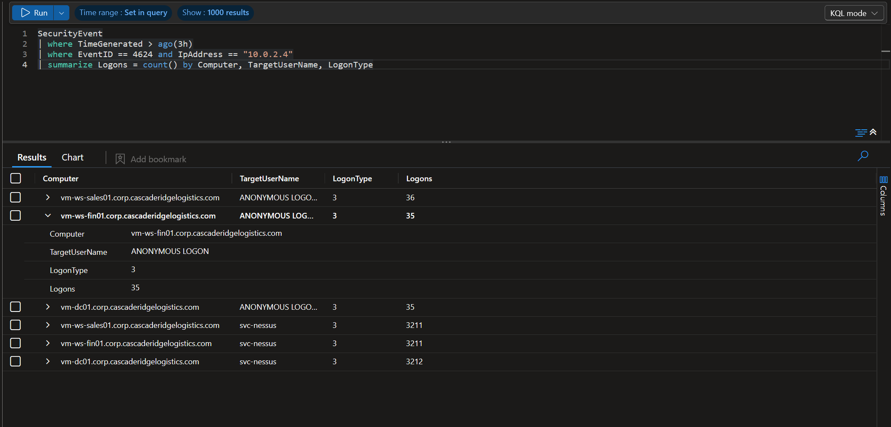

**Someone added to an admin group (event 4732).** This is one of the most watched events in a SOC, because attackers add themselves to admin groups to keep access. It shows me adding the scanner group on the DC, and the two workstations adding it through the GPO. Telling "a person did this" from "Group Policy did this" matters when you investigate.

```kql
SecurityEvent
| where TimeGenerated > ago(7d)
| where EventID == 4732
| project TimeGenerated, Computer, Group = TargetUserName, AddedMember = MemberName, AddedBy = SubjectUserName
```

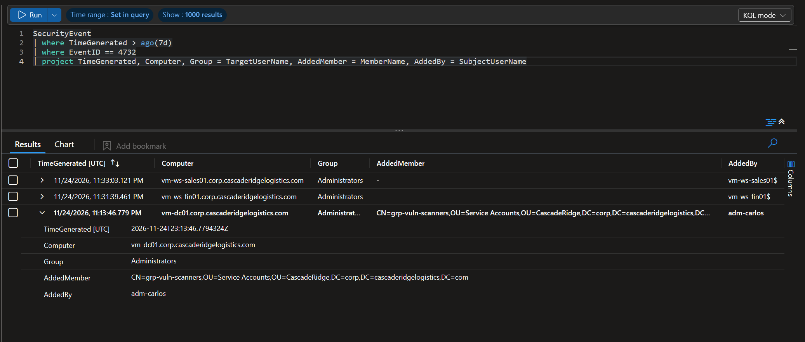

**The scanner using sudo on the CRM**, exactly as designed:

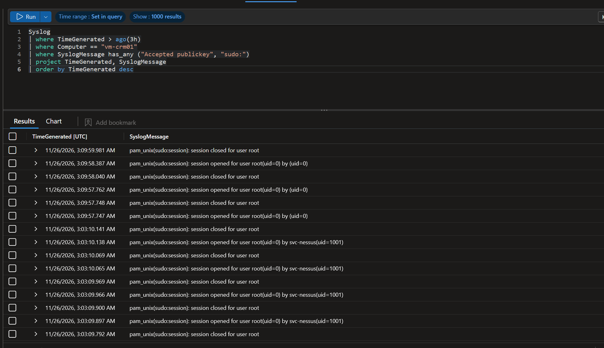

**Key Vault secret reads**, from the CRM reading its database password:

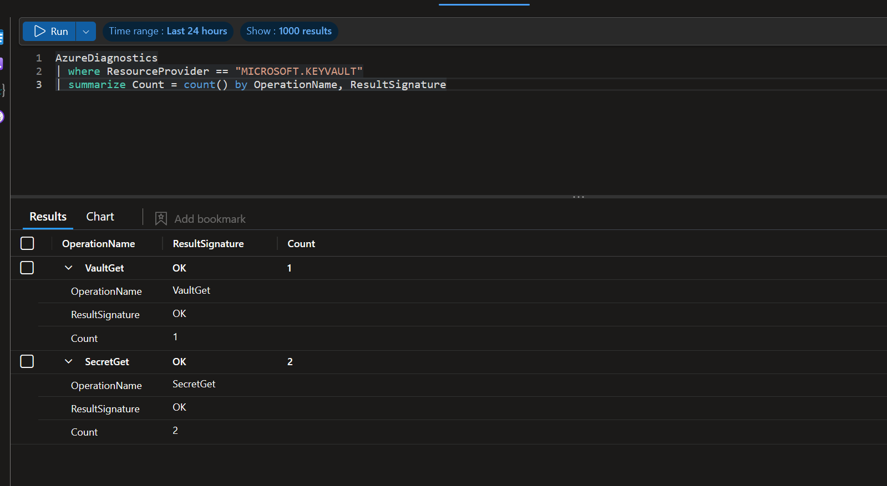

### The detection rules

I built two rules myself, because building them teaches you how they work, and turned on one template:

| Rule | Severity | What it catches | MITRE |
|---|---|---|---|
| Account locked out | Medium | Event 4740, possible password guessing | T1110 Brute Force |
| Member added to privileged group | High | Anyone added to Administrators, Domain Admins and similar groups | T1098 Account Manipulation |
| Privileged Role Assigned Outside PIM (template) | Low | Someone given an Entra admin role directly, skipping PIM | T1078 Valid Accounts |

The custom rules run every 5 minutes and look back 10 minutes. The overlap means a log that arrives a few minutes late still gets checked.

```kql
SecurityEvent
| where EventID == 4740
| project TimeGenerated, Computer, LockedAccount = TargetUserName, CallerComputer = TargetDomainName
```

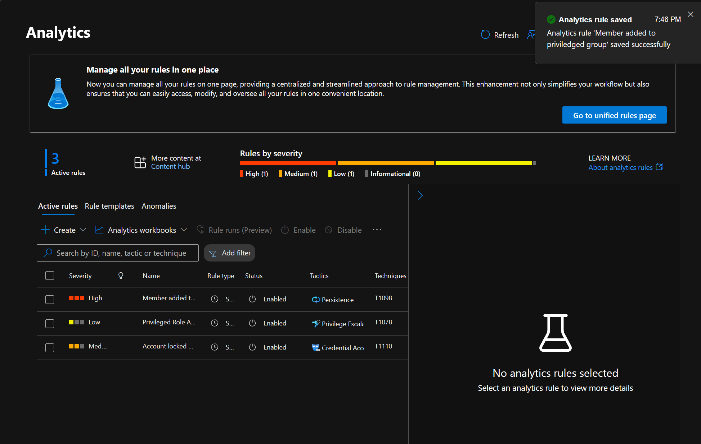

### The test: locking out Marcus

I tried to RDP into the Finance workstation as Marcus with the wrong password five times. The lockout policy from Phase 4 locked the account, and the logs showed it all: five failed logons (4625) from my VPN address, then the lockout (4740) on the DC.

The **4625s from 10.0.2.4 with the account "$"** further down are the Nessus scanner trying blank and guest logins during the scan. Without context those look like an attack. Knowing your own scanner's IP is how you rule them out quickly.

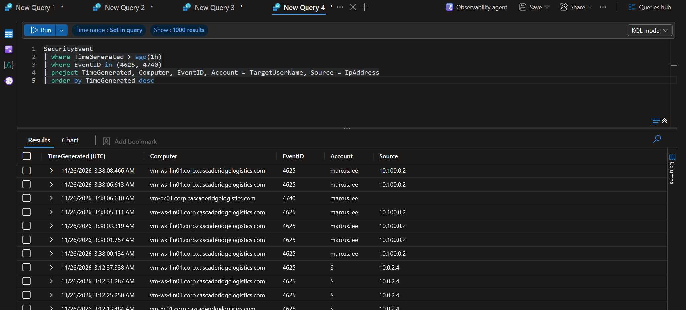

About 8 minutes later, Sentinel opened **incident 1: Account locked out**, mapped to Marcus's account.

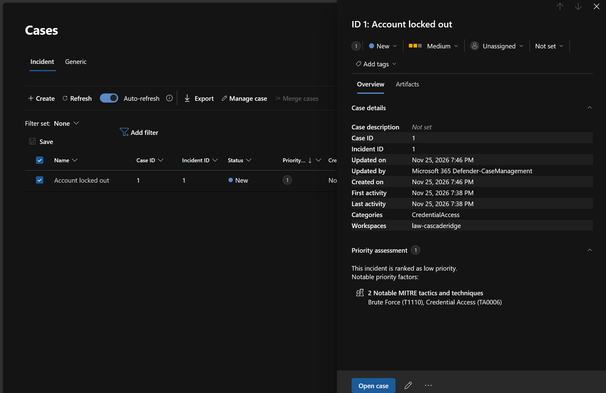

I closed it as **Benign Positive** since it was a planned test, the same way a SOC would close a known test.

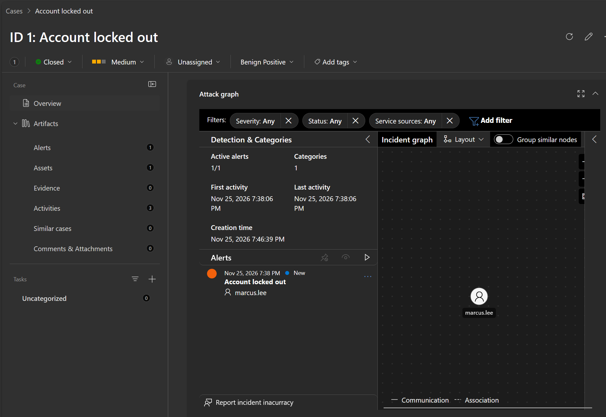

## Problems I hit

* **"No permissions" on the Entra ID connector.** My Global Admin role is PIM-eligible, not permanent, so I had to activate it first.
* **The quota page said I didn't have permission** even though I'm Owner on the subscription. A support request got the vCPU limit raised in minutes.
* **The first VM sizes I picked weren't available** in West US for my subscription. I ended up on D2as_v6.
* **The scanner couldn't resolve any names** until I gave it a DNS rule on the DC's NSG. Same lesson as the CRM in Phase 5: every new machine that uses the DC for DNS needs to be on the list.
* **Access denied creating the scan account** because my PowerShell window wasn't elevated. UAC strips admin rights from admin accounts until you run as administrator.
* **The incident didn't show up at first** because the Defender portal filters out low priority incidents by default. My lockout incident had a priority score of 1.
* **Nessus PDF export isn't in the free version,** so screenshots are my evidence.

## What's next

Phase 7: an agentic AI system in the sandbox spoke. It will have its own identity, limited tools, human approval for risky actions, and everything it does will be logged to Sentinel.

## Key takeaway

Monitoring only counts if you've proven it works. I didn't just turn on Sentinel and hope. I checked every log source with a query, broke something on purpose, and watched the alert fire.
